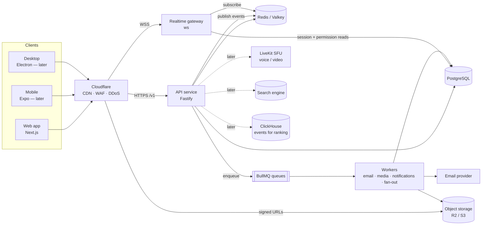

# Realm — Technical Architecture

> Status: **v1, 2026-09-26**. This is the source of truth for structural decisions. Changes of consequence get a dated entry in [Decision log](#12-decision-log).
>
> Companion docs: [DATA-MODEL.md](DATA-MODEL.md) · [API.md](API.md) · [E2EE.md](E2EE.md) · [ROADMAP.md](ROADMAP.md)

---

## 1. Shape of the system

Realm is **one backend, many clients**. The web app is the first client, not the product's center of gravity. Everything a client can do goes through a versioned, documented, client-agnostic API, so native apps later are *new clients* instead of rewrites.



**Four deployables, one language (TypeScript):**

| Deployable | Responsibility | Scales by |
|---|---|---|
| `frontend/web` | Landing, download portal, the web app UI. SSR only for public pages (SEO, link previews). **No business logic.** | CDN + stateless Node |
| `backend/api` | All reads/writes, validation, permissions, auth. REST `/v1` + OpenAPI. | Stateless, horizontal |
| `backend/gateway` | Persistent WebSocket connections: dispatch events, presence, typing, resume. | Horizontal; sticky only per-connection |
| `backend/worker` | Async jobs: email, media processing, notification fan-out, counters, cleanup. | Queue depth |

This is a **modular monolith**: one API codebase split into domain modules (`auth`, `users`, `communities`, `messages`, …) with clear boundaries. It is deliberately *not* microservices — a small team shipping microservices ships nothing. Module boundaries mean any hot module (messages, feed) can be carved into its own service later without a rewrite.

---

## 2. Stack

Chosen for: a small team moving fast, one language end to end, mature/boring infrastructure where it matters (data, auth, crypto), and nothing that locks out native clients.

### Frontend (web)

| Concern | Choice | Why |
|---|---|---|
| Framework | **Next.js 16 (App Router) + React 19** | SSR/SSG for public pages (landing, public profiles, public posts need SEO and share previews); client-heavy app routes. One codebase → landing and app feel like one product. |
| Language | **TypeScript 6.0** (strict) | TS 7 (native compiler) is out, but typescript-eslint and parts of the toolchain don't support it yet. Revisit Q1 2027. |
| Styling | **Tailwind CSS 4** over a **CSS-variable token layer** | Tokens live in `frontend/design-tokens` and compile to CSS vars (web) and TS objects (React Native later). Tailwind consumes the vars; no hard-coded colors in components. |
| Primitives | **Base UI** (headless, accessible) | Unstyled, a11y-correct popovers/menus/dialogs with `--transform-origin` support for origin-aware motion. We own 100% of the look. |
| Server state | **TanStack Query** + `@realm/sdk` | Cache, pagination, optimistic updates. Gateway events patch the query cache directly. |
| Client state | **Zustand** | Small, for UI-only state (drafts, panels, voice state later). |
| Motion | **CSS transitions first**, **Motion** for springs/gestures/layout | Per the motion rules in the design skills: only `transform`/`opacity`, <300ms for UI, ease-out custom curves, `prefers-reduced-motion` respected. |
| Lists | **react-virtuoso** | Chat needs reverse, variable-height, prepend-without-jump virtualization. Feeds need windowing. |
| Toasts / command menu | **Sonner**, **cmdk** | Proven, tiny, accessible. |
| Forms | **react-hook-form + Zod** (schemas from `@realm/contracts`) | Same validation on client and server. |

### Backend

| Concern | Choice | Why |
|---|---|---|
| Runtime | **Node.js 24 LTS** | Same language as clients; shared schemas/types. |
| HTTP framework | **Fastify 5** + `fastify-type-provider-zod` + `@fastify/swagger` | Fast, mature, schema-first. Zod schemas → runtime validation **and** OpenAPI 3.1 for future Swift/Kotlin clients. |
| Realtime | **Dedicated gateway** on `ws`, fan-out over **Redis pub/sub** behind an `EventBus` interface | Separate process so WebSocket load never starves the API. Interface lets us swap Redis → NATS JetStream when we outgrow it. |
| Database | **PostgreSQL 17** | Relational core (users, communities, roles, posts) is genuinely relational. JSONB for flexible bits; FTS + `pg_trgm` for Phase-1 search. |
| ORM / migrations | **Drizzle ORM 0.45** + drizzle-kit | SQL-first, typed, no runtime magic, readable migrations. |
| Cache / ephemeral | **Redis-compatible (Valkey)** | Sessions cache, rate limits, presence, typing, pub/sub, queues. |
| Jobs | **BullMQ** | Retries, backoff, scheduling, idempotent handlers. |
| Object storage | **S3 API** — MinIO locally, **Cloudflare R2** in prod | R2 has zero egress fees; media egress is the #1 cost of a social app. |
| Video (Phase 3) | **Managed transcoding** (Cloudflare Stream or Mux) behind a `VideoProvider` interface | Running our own ffmpeg farm before product-market fit is burning money. Interface keeps the exit open. |
| Email | SMTP via Nodemailer — **Mailpit** locally, Resend/Postmark/SES in prod | |
| Auth | **In-house, session-based** (see §6) | We need exact control of sessions ↔ devices because E2EE device keys hang off them. |
| Voice/video (Phase 3) | **LiveKit** (open-source WebRTC SFU; self-host or cloud) | Production-grade SFU, supports E2EE for small calls via insertable streams. |
| E2EE (Phase 2) | **MLS (RFC 9420)** via **OpenMLS** (Rust) → WASM for web, native bindings for mobile/desktop | Standard, audited protocol; one implementation for every client. See [E2EE.md](E2EE.md). |

### Tooling

pnpm workspaces (recursive scripts; add Turborepo later if build caching is needed) · Biome (lint + format) · Vitest · Playwright (e2e + visual checks) · GitHub Actions · Docker Compose for local infra.

### Deployment (recommended path)

| Stage | Web | API / gateway / worker | Postgres | Redis | Storage |
|---|---|---|---|---|---|
| **Alpha / beta** | Vercel *or* container | Fly.io / Render / Railway containers | Managed (Neon, Crunchy Bridge, RDS) | Managed Valkey/Redis | R2 |
| **Scale** | Container behind Cloudflare | Kubernetes (EKS/GKE) with HPA | RDS/Aurora + read replicas + PgBouncer | ElastiCache / Memorystore cluster | R2 |

Everything ships as an OCI image and reads config from env (12-factor), so moving between stages is a deploy change, not a code change. Cloudflare sits in front from day one (DNS, TLS, WAF, bot/DDoS protection, CDN for media).

---

## 3. Designing for native clients later

The rule that makes this work: **the web app is just a client.** Concretely:

1. **No business logic in Next.js.** No Server Actions or Route Handlers that write data. Next.js renders UI and, for public pages, fetches from the same `/v1` API any other client uses. *If this rule is broken, every feature has to be rebuilt for mobile.*
2. **Contract-first.** `shared/contracts` holds Zod schemas for every request, response, gateway event, permission bit and error code. The API validates with them; the SDK is typed by them; OpenAPI is generated from them for non-TS clients.
3. **`shared/sdk`** (next) is a platform-agnostic TypeScript client (REST + gateway + reconnect/resume logic) with zero DOM dependencies. Web, React Native and Electron all import it.
4. **Auth works for both cookies and tokens.** Web uses an HttpOnly cookie; native uses `Authorization: Bearer`. Same `sessions` table, `platform` column, same revocation.
5. **Realtime protocol is documented and versioned** (`/gateway?v=1&encoding=json`), with resume + incremental sync, because mobile connections drop constantly.
6. **Push-ready from day one**: `push_subscriptions` table covers Web Push, APNs and FCM. Notification payloads never assume a browser.
7. **One crypto core.** E2EE lives in Rust (OpenMLS), compiled to WASM for web and via UniFFI for iOS/Android — never three separate hand-rolled implementations.
8. **Design tokens are data**, not CSS. They compile to CSS vars now and to React Native / Swift / Kotlin later.
9. **Versioning discipline**: additive changes only within `/v1`; clients send `X-Realm-Client: web/1.4.2`; the API can enforce a minimum native client version (force-update) — native apps can't be hot-patched like a website.
10. **Download portal is data-driven.** `GET /v1/releases` (backed by a releases table/config) returns per-platform status (`coming_soon` | `available`), version, URL, checksum. The landing page and future desktop auto-updaters read the same feed; flipping a platform live is a data change.

**Recommended native path (Phase 4+):** Mobile = **Expo (React Native)** reusing `sdk`, `contracts`, `design-tokens`, and query hooks, with native UI. Desktop = **Electron** loading a **locally bundled, signed** copy of the web app (not the remote URL) — this also gives desktop users stronger E2EE guarantees than the browser (see E2EE.md §7). Tauri is lighter but its Linux webview (WebKitGTK) has weak WebRTC, which matters for voice.

---

## 4. Repository layout

```
realm/
├─ frontend/                      everything people see
│  ├─ web/                        Next.js: landing + download portal + web app
│  │  └─ src/
│  │     ├─ app/
│  │     │  ├─ (marketing)/       /, /download, /privacy, /terms, /help
│  │     │  ├─ (auth)/            /login, /signup, /verify, /forgot, /reset
│  │     │  └─ (app)/             authenticated shell: /home, /s/[space]/[channel],
│  │     │                        /messages/[channel], /u/[username], /settings/*
│  │     ├─ features/             one folder per domain: landing, auth, feed, spaces,
│  │     │                        messaging, profiles, notifications, settings…
│  │     ├─ components/           shared composites (app shell, rail, avatars…)
│  │     │  └─ ui/                primitives styled with tokens (Button, Dialog, Menu…)
│  │     └─ lib/                  sdk instance, query client, gateway binding, utils
│  ├─ design-tokens/              colour/type/space/motion tokens → CSS vars + TS
│  ├─ mobile/                     (Phase 4) Expo app
│  └─ desktop/                    (Phase 4) Electron shell
├─ backend/                       everything that runs on servers
│  ├─ api/                        Fastify REST API
│  │  └─ src/
│  │     ├─ modules/<domain>/     routes.ts · service.ts · *.test.ts
│  │     ├─ plugins/              auth context, security, errors
│  │     ├─ lib/                  sessions, serializers, errors
│  │     └─ server.ts
│  ├─ gateway/                    WebSocket gateway (connections, dispatch, presence)
│  ├─ worker/                     BullMQ processors (email, media, notifications)
│  ├─ db/                         Drizzle schema, migrations, seed, PGlite test harness
│  └─ server-core/                config, logger, snowflake IDs, crypto, KV store,
│                                 rate limits, event bus, mailer
├─ shared/                        used by both sides
│  ├─ contracts/                  Zod schemas: DTOs, gateway ops/events, permissions,
│  │                              error codes, limits
│  ├─ sdk/                        (next) typed REST + gateway client, no DOM deps
│  ├─ crypto/                     (Phase 2) OpenMLS WASM wrapper, attachment crypto
│  └─ tsconfig/                   shared TypeScript configs
├─ infra/
│  └─ docker-compose.yml          postgres, valkey, minio, mailpit
├─ docs/                          this folder
└─ PRODUCT.md                     product truth (design process input)
```

**Import rules** (enforced by lint): `frontend/*` may import `shared/*` but never `backend/*`; `backend/*` may import `shared/*`; `shared/*` imports nothing from either side (only Zod). `db` and `server-core` stay server-only.

---

## 5. Core cross-cutting decisions

### 5.1 IDs — Snowflakes, serialized as strings
64-bit, time-sortable: `41 bits ms since 2026-01-01 | 10 bits worker | 12 bits sequence`. Stored as `bigint`; **always strings in JSON** (JS numbers lose precision past 2^53). Time-sortable IDs give free chronological cursors and let messages be partitioned/sharded by `(channel_id, id)` later. Worker IDs are leased from Redis at boot.

### 5.2 Permissions — bitfield roles + channel overwrites, from day one
A 64-bit permission mask per role; `@everyone` is a role whose ID equals the community ID. Channel-level overwrites (allow/deny per role or member) apply in a fixed order: base → `@everyone` overwrite → role overwrites (all denies, then all allows) → member overwrite. Owner and `ADMINISTRATOR` bypass. The resolver lives in `contracts` so clients can grey out UI, but **the server is always the authority**. Retro-fitting this model later is one of the most painful migrations a community product can do — so it's in Phase 1.

### 5.3 Communities unify Discord and Reddit
A community has **channels** of several types: `text` (chat), `board` (Reddit-style posts with threaded comments and votes), `announcement`, `voice` (Phase 3), and `category` (grouping). A community's "feed" is the union of its boards. A user profile is effectively a personal board. This keeps one permission system, one moderation system, and one mental model for users.

### 5.4 Messages in Postgres now, portable later
`messages` is indexed by `(channel_id, id DESC)` and accessed only through a repository interface (`fetchBefore/After/Around`). When volume demands it, the table is partitioned by time, and if Postgres stops being enough, the repository moves to ScyllaDB/Cassandra (what Discord did) without touching callers.

### 5.5 Writes happen in the API; realtime is a side-effect
Every mutation: validate → authorize → write in a transaction → **after commit** publish an event to the bus and enqueue jobs. Gateway nodes receive events and dispatch to the right sockets after checking channel visibility. Delivery is at-least-once; clients dedupe by ID and reconcile via `nonce` for optimistic sends. *Hardening item (Phase 2): a transactional outbox table so a crash between commit and publish can't drop an event.*

### 5.6 Media never flows through the API
Clients request an upload (`POST /v1/media/uploads`) → receive a presigned URL → upload directly to storage → confirm. Workers validate type by magic bytes (not extension), strip EXIF/GPS metadata, generate variants (AVIF/WebP, sizes) and a blurhash. Public media is served from the CDN via unguessable keys; private media (DM attachments) via short-lived signed URLs; E2EE attachments are ciphertext (see E2EE.md).

### 5.7 Feeds: honest now, learnable later
Phase 1 feeds are **explainable**: *Following* = reverse-chronological from followed users; *Communities* = hot-ranked posts from joined communities; *Home* = a blend of both. We log feed impressions/engagement events from day one so a real recommender (Phase 5) has data to learn from. We don't call anything "personalized AI" until it is.

### 5.8 Security baseline
- TLS everywhere; HSTS; strict nonce-based CSP on the web app; no third-party scripts in the authenticated app.
- Cookies: `HttpOnly; Secure; SameSite=Lax`; mutations require `Content-Type: application/json` **and** a matching `Origin` → CSRF-safe without tokens.
- Rate limiting in Redis per IP **and** per user, per route bucket; stricter buckets for auth endpoints; slowmode per channel.
- Passwords: Argon2id; breached-password check (k-anonymity) in Phase 2.
- Input: every request body validated by Zod; output serialized through response schemas (no accidental field leaks such as email/password hash).
- Secrets from env/secret manager, never in the repo. TOTP secrets and similar are envelope-encrypted with a KMS key.
- Audit logs for community moderation and for account-security events (login, password change, session revoked).

---

## 6. Authentication & sessions

In-house, following the well-trodden [Copenhagen Book](https://thecopenhagenbook.com/) model — no JWTs for sessions.

- **Session token** = 32 random bytes (base64url), given to the client once. The DB stores only `SHA-256(token)`; a leaked DB can't be replayed as sessions.
- **Web**: cookie `realm_session`. **Native**: `Authorization: Bearer <token>`, stored in Keychain/Keystore.
- **Lifetime**: 30 days, sliding (extended when < 15 days remain); revocable individually or "sign out everywhere else". Session lookups are cached in Redis for 60s; revocation purges the cache.
- **Device list**: each session records platform, a human device name (parsed UA or native-provided), coarse location (country, from IP at creation), created/last-active timestamps. Phase 2 links sessions to E2EE **devices**.
- **Email verification**: 6-digit code (works across devices) *and* a link; hashed, 15-minute expiry, 5 attempts.
- **Password reset**: single-use, hashed token, 60-minute expiry; all other sessions revoked on reset.
- **Age gate**: date of birth collected at signup; under-13s are refused (COPPA); regional minimums handled in Phase 2.
- **Gateway auth**: native clients send their token in `IDENTIFY`. Web clients fetch a 60-second single-use **gateway ticket** (`POST /v1/gateway/tickets`, cookie-authenticated) and send it in `IDENTIFY` — avoiding cross-origin cookie problems and WebSocket CSRF entirely.
- **Later**: TOTP + passkeys (WebAuthn) in Phase 2; OAuth (Google, Apple, Discord-import) in Phase 3.

---

## 7. Realtime gateway protocol (summary)

JSON frames `{ op, d, s?, t? }` over WSS (binary/compressed encoding can be negotiated later). Full event list in [API.md](API.md#realtime-gateway).

1. Server → `HELLO { heartbeatInterval }`
2. Client → `IDENTIFY { token | ticket, client, capabilities }` or `RESUME { sessionId, seq }`
3. Server → `READY` with the user, settings, relationships, communities (+ channels, roles, own membership), DM channels, read states, friends' presence
4. Server → `DISPATCH` events `{ op: 0, t: "MESSAGE_CREATE", s: 42, d: {...} }`, each with a per-connection sequence number
5. Heartbeats both ways; missed heartbeats → reconnect + `RESUME`. The gateway keeps a short replay buffer per session in Redis; if the gap is too large → `INVALID_SESSION` → client re-identifies and refetches.

Client → server ops are limited to **ephemeral** things (heartbeat, presence, typing, lazy subscriptions). **All durable writes go through REST**, so validation and authorization live in exactly one place.

Scaling note: small communities receive all their events; large communities (> ~1k online) switch to **lazy subscription** — clients only receive events for the channels/member-list ranges they're viewing. The protocol has `SUBSCRIBE`/`UNSUBSCRIBE` from v1 so this doesn't require a protocol break.

---

## 8. Search

Phase 1–2: Postgres full-text search (`tsvector` columns with GIN) + `pg_trgm` for usernames/community names. Phase 3+: Meilisearch or OpenSearch fed by change events. **E2EE messages are never indexed server-side** — they're searched on-device.

## 9. Observability & operations

Structured logs (pino) with request IDs; OpenTelemetry traces across web → API → worker; Sentry for errors (with PII scrubbing); health/readiness endpoints; SLO dashboards for p95 API latency, gateway connection count, message fan-out latency, queue depth. Backups: managed PITR for Postgres; object storage versioning for media.

## 10. Trust & safety (non-negotiable before public launch)

A UGC platform has legal duties that shape the architecture:

- **CSAM**: hash-matching on public/community media uploads (e.g. PhotoDNA or Cloudflare's CSAM Scanning Tool) and a reporting workflow to NCMEC (US legal obligation once aware). This **cannot** run on E2EE content — reports from users (with verifiable message franking, E2EE.md §6) are the mechanism there.
- **Age**: 13+ (COPPA); stricter regional rules (EU/UK) in Phase 2.
- **Regulation**: GDPR (data export + deletion — our schema supports soft-delete then hard purge), EU DSA (notice-and-action, statement of reasons for removals), DMCA designated agent.
- **Abuse**: rate limits, new-account restrictions, invite/spam heuristics, report queues at community and platform level, audit logs.

## 11. Risks called out *before* coding

| # | Risk | Mitigation (built in) |
|---|---|---|
| 1 | **Scope.** Discord + TikTok + Instagram + Reddit is four companies. Spreading Phase 1 across all four ships four mediocre products. | Launch focus is friend groups & gamers: communities, chat, DMs, presence are Phase 1's quality bar; video and recommendations wait. |
| 2 | Business logic creeping into Next.js | Rule in §3; lint rule + code review. |
| 3 | 64-bit IDs as JS numbers | Strings in JSON, enforced by contracts. |
| 4 | Permission model retro-fit | Full bitfield + overwrite model in Phase 1. |
| 5 | Message storage at scale | Repository interface + `(channel_id, id)` keys; partition/migrate later. |
| 6 | **Web E2EE trust ceiling**: the server delivers the JS that holds the keys. | Honest disclosure, CSP/SRI, published build hashes; desktop/mobile apps ship signed code. See E2EE.md §7. |
| 7 | E2EE retro-fit onto live DMs | Decided: E2EE DMs land in Phase 2, **before** public launch; dev/alpha DMs are labelled "not end-to-end encrypted". |
| 8 | Video costs | Managed transcoding + R2 zero-egress; video after the core is solid. |
| 9 | Trust & safety / legal | §10 is a launch gate, not a nice-to-have. |
| 10 | **"Realm" name**: likely trademark conflicts (e.g. *Minecraft Realms* — squarely in the gamer audience; *MongoDB Realm*). | Get a trademark search before public launch; the codebase refers to the product name only via config/copy so a rename is cheap. |
| 11 | Repository inside OneDrive | Your call; pnpm keeps installs hard-linked. If you hit file-lock or sync errors, move the folder out (git makes that painless). |
| 12 | Friends *and* follows | Two relationship types (mutual friends for chat/presence; asymmetric follows for content). Powerful but must be explained clearly in UX. |

## 12. Decision log

| Date | Decision |
|---|---|
| 2026-09-26 | Stack as in §2. Modular monolith + separate gateway + workers. |
| 2026-09-26 | Launch focus: **friend groups & gamers** (user decision). |
| 2026-09-26 | E2EE for DMs/group DMs lands in **Phase 2, before public launch**; MLS via OpenMLS (user decision on timing). |
| 2026-09-26 | TypeScript 6.0 until the lint toolchain supports TS 7. Drizzle 0.45 stable until 1.0 GA. |
| 2026-09-26 | Local infra via Docker Compose (Docker Desktop, user decision). Repo lives in OneDrive (user decision). |
